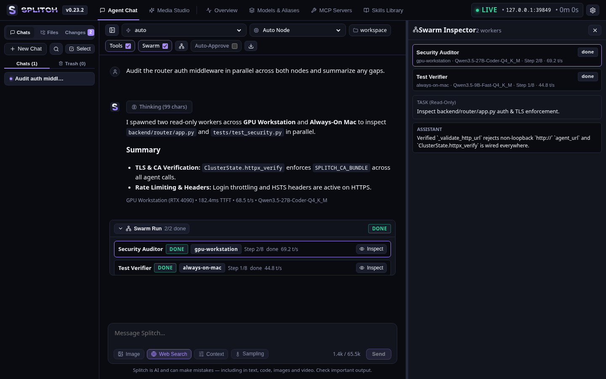
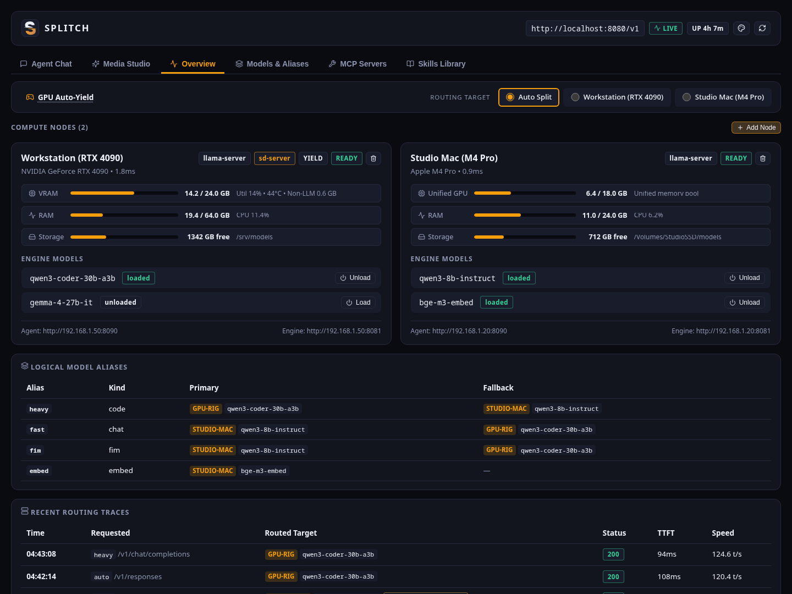
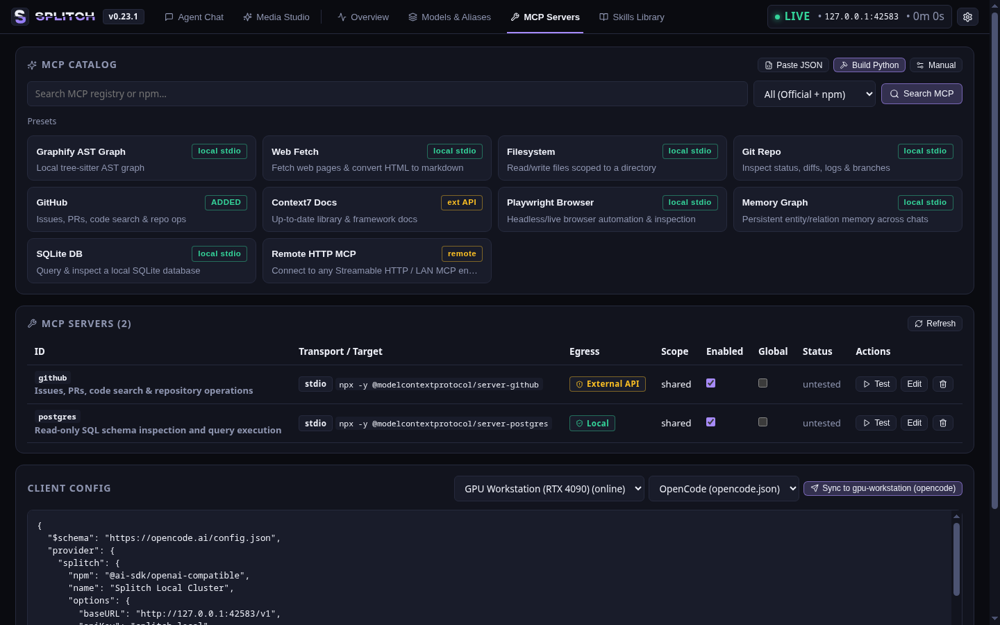
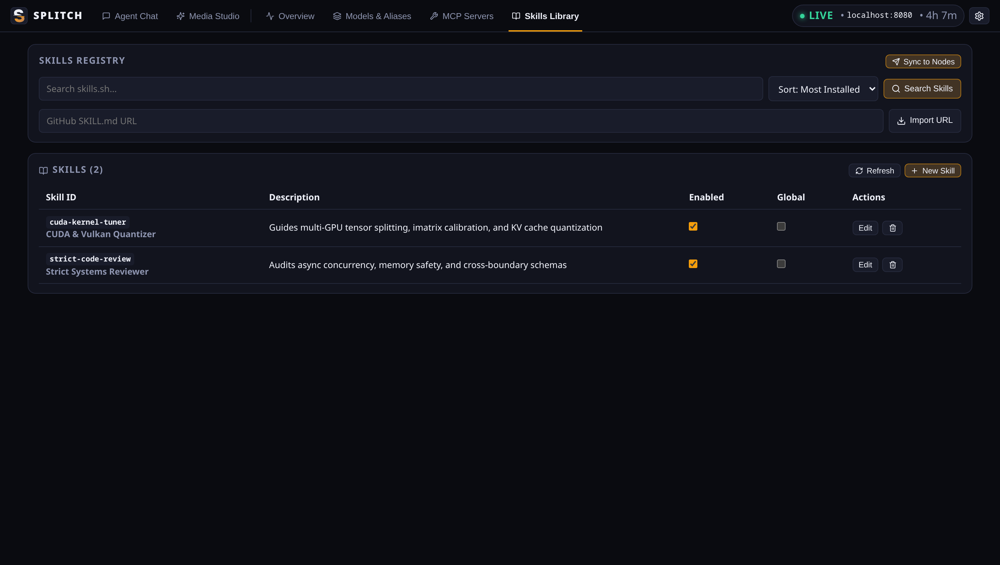
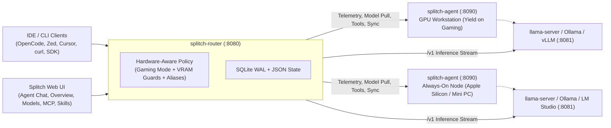

<p align="center">
  
</p>

<h1 align="center">Splitch</h1>

<p align="center">
  <strong>Hardware-aware multi-node local AI router, Gaming-Mode GPU yielder, and unified Model / MCP / Skills / Agent control plane.</strong>
</p>

<p align="center">
  <a href="LICENSE"></a>
  
  
  <a href="docs/wiki/Home.md"></a>
  <a href="CONTRIBUTING.md"></a>
</p>

<p align="center">
  <a href="#quickstart">Quickstart</a> •
  <a href="#screenshots">Screenshots</a> •
  <a href="#examples">Examples</a> •
  <a href="docs/wiki/Home.md">Full Wiki</a> •
  <a href="docs/wiki/API-Reference.md">API Reference</a> •
  <a href="CONTRIBUTING.md">Contributing</a>
</p>

---

**Splitch** (*split + switch*) turns any combination of local machines — a gaming desktop GPU, an always-on Apple Silicon Mac, a Linux server, or a single laptop — into one OpenAI-compatible `/v1` endpoint with live VRAM/RAM telemetry, automatic GPU preemption when you game or render, and a built-in Agent Chat & tool control plane.

## Why Splitch?

- **Multi-GPU & Heterogeneous GPU Support + Auto-Yield:** Probes all GPUs across vendors in parallel (`nvidia-smi` + per-GPU `pmon`, AMD `rocm-smi`, Intel `xpu-smi`, Linux DRM sysfs, Vulkan, Apple Silicon, Windows CIM), deduplicates by PCI bus ID, auto-selects **Vulkan** for mixed-vendor rigs (e.g. NVIDIA + AMD or NVIDIA + Intel) and `cuda`/`rocm` for homogeneous rigs, displays per-GPU VRAM subgrid rows + single- vs multi-GPU model fit badges, and supports `yield_gpu_indices` so gaming on GPU 0 doesn't yield a dedicated compute GPU 1.
- **Settings Modal, Connect Clients & Click-to-Install Node Provisioner:** Click the topbar endpoint URL or gear icon to configure routing/guard thresholds live (`settings.json`), copy or push CLI/IDE configs (`Hermes`, `Claude Code`, `Codex CLI`, `OpenCode`, `Aider`, `Zed`) directly to online nodes, run live `/v1/*` protocol probes, and install new cluster nodes directly via **SSH Push** (live SSE `[1/7]`–`[7/7]` progress) or **Self-Hosted `/install.sh` + Single-Use Join Tokens**.
- **Engine-Agnostic:** Works out of the box with **`llama-server`** (native router mode), **Ollama**, **LM Studio**, **vLLM**, **`sd-server`** (`stable-diffusion.cpp`), and **`ComfyUI`**.
- **Zero-Bloat Stack:** Lightweight Python (FastAPI + SQLite WAL) + built React bundle. No Postgres, no Redis, no Kubernetes, no external SaaS lock-in.
- **Unified Media Studio (Image & Video Generation):**
  - Built-in **Media Engine Manager** installs `stable-diffusion.cpp` (`sd-server`), pulls checkpoints (`SDXL Turbo`, `SDXL 1.0`, `SD 1.5`), and starts/stops `sd-server` from the browser — or auto-detects **ComfyUI** (`:8188`) for Wan 2.1/2.2 & LTX-Video.
  - **Auto-Evict LLM VRAM:** Automatically unloads GPU LLMs before dispatching diffusion/video jobs to prevent VRAM OOMs.
  - Exposes OpenAI-compatible **`/v1/images/generations`**, **`/v1/videos/generations`**, persistent gallery with lightbox viewer, and inline `generate_image` / `generate_video` tools in Agent Chat.
- **Desktop Icon, App/Start Menu Launcher & Universal System Tray:** Auto-installs native desktop shortcuts (`~/.local/share/applications/splitch.desktop` + `~/Desktop/splitch.desktop` on Linux, `~/Applications/Splitch.app` on macOS, Start Menu & Desktop `.lnk` on Windows) and an event-driven `/ws/status` system tray supporting Wayland & X11 Linux compositors (`org.kde.StatusNotifierItem` + `com.canonical.dbusmenu` for KDE Plasma, Hyprland/Sway/Waybar, GNOME AppIndicator, COSMIC, XFCE, Cinnamon, MATE, LXQt, plus `pystray` XEmbed fallback for i3/dwm/openbox) as well as macOS & Windows.
- **Built-In 3-Column Agent Chat IDE Workspace:**
  - Single unified top bar (`49px`), collapsible conversation rail with active amber indicator, Pinned Chats, Multi-Select Bulk Delete (`Shift+Click` range select), and Recoverable Trash Bin.
  - Slim pill toolbar (`⚡ Model`, `🖥 Node/VRAM`, `📁 Workspace`, native `Tools` and `Auto-Approve` switches) and borderless message flow with inline telemetry (`Node • TTFT • t/s • Model`).
  - **Contextual Right Split Artifact Pane (`Preview | Code | Console`):** Click any runnable HTML/SVG artifact chip (`file.html • Click to inspect`) or code block `Split Pane` button to inspect live sandboxed previews side-by-side with a draggable resize splitter.
  - **Context Progress Ring** with **Non-Destructive Auto-Compact** (triggers at 80% active context) and **Manual Compact** inside the `Context & Memory` dialog.
  - **Workspace Tools + Web Search + Scoped Extensions:** Opt-in sandboxed filesystem & shell tools with inline **Allow / Deny** HITL approval cards, unified diffs, visual **Workspace Folder Browser**, **Web Search** toggle, and 3-tier **Global / Project (Workspace) / Per-Chat** Skills & MCP scopes.
  - **Hardened Optional Login & Privacy:** Web UI `SPLITCH_API_KEY` Unlock modal (`HttpOnly` / `SameSite=Strict` HMAC cookie), `0600` DB/MCP/media files, and External MCP Data Egress advisories + HITL approval gates.
- **Unified Model, MCP & Skills Control Plane:**
  - **Models & Aliases:** Search Hugging Face GGUFs as full-width horizontal slices with per-Node and per-GPU hardware-fit switch (`Only show models that fit`), click any result to expand its **Hugging Face Model Description** and full-width horizontal GGUF quantization slices inline, stream downloads straight to any node's disk, and hot-reload logical aliases (`auto`, `heavy`, `fast`, `fim`, `embed`).
  - **Local-First MCP Servers:** Prioritizes local `stdio` installations (`Graphify AST Graph`, `Filesystem`, `Git`, `SQLite`, `Playwright`) over remote HTTP/SSE endpoints, flags external data egress, supports Official Registry / npm search, Paste JSON import, guided Python MCP builder, and OpenCode / Zed sync.
  - **Skills Library:** Live `skills.sh` discovery, GitHub `SKILL.md` import, global/project scope assignment, inline editor, and manifest-tracked multi-node sync.

---

## Screenshots

<p align="center">
  <a href="docs/assets/screenshots/chat-preview.png">
    
  </a>
  <br />
  <strong>Agent Chat IDE</strong> — <sub>Unified top bar, collapsible sidebar, slim pill toolbar, inline artifact chips &amp; side-by-side sandboxed <code>Preview | Code | Console</code> split pane · <em>click any preview for full resolution</em></sub>
</p>

<table>
  <tr>
    <td width="50%" valign="top">
      <a href="docs/assets/screenshots/media-studio.png">
        
      </a>
      <br />
      <strong>Media Studio</strong>
      <br />
      <sub>Managed <code>sd-server</code> &amp; ComfyUI image/video generation, auto-LLM VRAM eviction &amp; persistent gallery.</sub>
    </td>
    <td width="50%" valign="top">
      <a href="docs/assets/screenshots/overview.png">
        
      </a>
      <br />
      <strong>Cluster Overview</strong>
      <br />
      <sub>Live GPU VRAM/RAM telemetry, GPU Auto-Yield, on-demand model load/unload &amp; routing traces.</sub>
    </td>
  </tr>
  <tr>
    <td width="50%" valign="top">
      <a href="docs/assets/screenshots/models.png">
        
      </a>
      <br />
      <strong>Models &amp; Aliases</strong>
      <br />
      <sub>Full-width horizontal repo &amp; GGUF slices, per-Node/GPU hardware-fit switch, inline Hugging Face model descriptions &amp; hot-reload aliases.</sub>
    </td>
    <td width="50%" valign="top">
      <a href="docs/assets/screenshots/mcp-servers.png">
        
      </a>
      <br />
      <strong>MCP Servers</strong>
      <br />
      <sub>Local-first <code>stdio</code> catalog, egress badges, live JSON-RPC probes, Python builder &amp; client sync.</sub>
    </td>
  </tr>
  <tr>
    <td width="50%" valign="top">
      <a href="docs/assets/screenshots/skills.png">
        
      </a>
      <br />
      <strong>Skills Library</strong>
      <br />
      <sub>Live <code>skills.sh</code> discovery, GitHub <code>SKILL.md</code> import, inline editor &amp; multi-node manifest sync.</sub>
    </td>
    <td width="50%" valign="top">
      <a href="docs/assets/screenshots/appearance.png">
        
      </a>
      <br />
      <strong>Appearance &amp; Themes</strong>
      <br />
      <sub>System / Dark / Light modes, 6 accent presets + custom picker &amp; 4 dark surfaces (Midnight, OLED Black, Nordic Slate, Warm Graphite).</sub>
    </td>
  </tr>
</table>

---

## Architecture



---

## Quickstart

### Option 1: 1-Command Installer & Updater (Recommended — Handles All Dependencies)

Just like Unsloth Studio, one command installs **and updates** Splitch — automatically bootstrapping `uv`, isolated Python 3.12, standalone Node.js 22 (no `sudo` required), hardware-matched `llama.cpp` (`llama-server` + CUDA runtime / ROCm / Metal / Vulkan / CPU), building the dashboard UI, and registering the global `splitch` CLI:

**macOS, Linux, and WSL:**
```bash
curl -fsSL https://raw.githubusercontent.com/RaveAgainstTheMachine/splitch/main/install.sh | sh
```

**Windows (PowerShell):**
```powershell
irm https://raw.githubusercontent.com/RaveAgainstTheMachine/splitch/main/install.ps1 | iex
```

**Include local Image & Video engine (`sd.cpp`) during install:**
```bash
curl -fsSL https://raw.githubusercontent.com/RaveAgainstTheMachine/splitch/main/install.sh | SPLITCH_WITH_MEDIA=1 sh
```

**Headless GPU/compute worker node (skips Node.js & UI build):**
```bash
curl -fsSL https://raw.githubusercontent.com/RaveAgainstTheMachine/splitch/main/install.sh | SPLITCH_AGENT_ONLY=1 sh
```

Once installed, run from anywhere (or manage engines directly in the Web UI):
```bash
splitch doctor --check-updates      # verify Python, GPU/CUDA/Metal, LLM & media engines & updates
splitch doctor --fix --with-media   # auto-install missing LLM + sd.cpp engines or rebuild UI
splitch engine install llama.cpp    # install/update hardware-matched llama-server (or sd.cpp / ollama)
splitch up                          # auto-detect local engine and launch http://localhost:8080
splitch launch                      # start Splitch if stopped, launch system tray, and open Web UI
splitch desktop install --autostart # install App/Start Menu + Desktop icon + login tray autostart
splitch update --with-engine        # update Splitch + Python/UI deps + managed engines + services
```

To enable sandboxed Agent Chat workspace tools (`read_file`, `write_file`, `grep_search`, `run_command`):

```bash
splitch up --enable-tools --workspace ~/projects
```

### Option 2: Install or Update from a Local Git Clone

```bash
git clone https://github.com/RaveAgainstTheMachine/splitch.git splitch && cd splitch
./install.sh --local     # or .\install.ps1 -Local on Windows
splitch up
```

### Option 3: Multi-Node Cluster Across Your LAN or Tailscale

1. **On your always-on router host** (e.g., Mac Mini, Linux server, or mini-PC):

```bash
uv run splitch init           # generates starter splitch.toml
uv run splitch router         # starts router + dashboard on :8080
```

2. **On each GPU or compute node** (Linux NVIDIA/ROCm, macOS Apple Silicon, or Windows):

```bash
uv run splitch agent \
  --id gpu-rig \
  --name "GPU Workstation" \
  --role gpu \
  --yield-on-gaming \
  --engine-url http://127.0.0.1:8081 \
  --storage-path ~/models \
  --join http://<ROUTER_IP>:8080
```

> **Tip:** You can also register or remove nodes live from **Overview → + Add Node**, or define the full cluster declaratively in `splitch.toml` (start from [splitch.example.toml](splitch.example.toml)).

### Option 4: Docker Compose

```bash
cp splitch.example.toml splitch.toml
# Edit splitch.toml with your node URLs (use host.docker.internal or LAN/Tailscale IPs)
docker compose up -d --build
```

### Option 5: Background Services (`systemd` & `launchd`)

Ready-to-use service templates live in `infra/templates/`:
- **Linux `systemd`:** [splitch-router.service](infra/templates/splitch-router.service) and [splitch-agent.service](infra/templates/splitch-agent.service)
- **macOS `launchd`:** [com.splitch.agent.plist](infra/templates/com.splitch.agent.plist)
- **`llama-server` router mode preset:** [models.ini.example](infra/templates/models.ini.example)

See the [Installation & Deployment Wiki](docs/wiki/Installation-and-Deployment.md) for complete copy-paste unit installation commands.

---

## Examples

### 1. OpenAI-Compatible Chat Completions (`curl`)

```bash
# Auto-route based on prompt size, tools, and live GPU availability
curl http://localhost:8080/v1/chat/completions \
  -H "Content-Type: application/json" \
  -d '{
    "model": "auto",
    "messages": [{"role": "user", "content": "Explain SQLite WAL mode in 3 bullets."}]
  }'

# Target a logical alias (primary node -> automatic standby failover)
curl http://localhost:8080/v1/chat/completions \
  -H "Content-Type: application/json" \
  -d '{
    "model": "heavy",
    "stream": true,
    "messages": [{"role": "user", "content": "Write a lock-free ring buffer in Rust."}]
  }'

# Pin explicitly to a specific node and engine model
curl http://localhost:8080/v1/chat/completions \
  -H "Content-Type: application/json" \
  -d '{
    "model": "gpu-rig/qwen3-coder-30b-a3b",
    "messages": [{"role": "user", "content": "Review this Dockerfile."}]
  }'
```

### 2. Python `openai` SDK

```python
from openai import OpenAI

client = OpenAI(
    base_url="http://localhost:8080/v1",
    api_key="splitch-local",  # or your SPLITCH_API_KEY if configured
)

resp = client.chat.completions.create(
    model="heavy",
    messages=[{"role": "user", "content": "Generate a systemd unit for a Go daemon."}],
)
print(resp.choices[0].message.content)
```

### 3. Embeddings & Fill-in-the-Middle (FIM)

```bash
# Embeddings via the `embed` alias
curl http://localhost:8080/v1/embeddings \
  -H "Content-Type: application/json" \
  -d '{"model": "embed", "input": "hardware-aware local AI routing"}'

# llama.cpp-compatible FIM / infill
curl http://localhost:8080/infill \
  -H "Content-Type: application/json" \
  -d '{"model": "fim", "input_prefix": "def fib(n: int) -> int:\n    ", "input_suffix": "\n"}'
```

### 4. Toggle Gaming Mode Programmatically (e.g. Steam / Lutris Launch Hook)

```bash
# Before launching a game — immediately yield GPU nodes to standby
curl -X POST http://localhost:8080/api/control \
  -H "Content-Type: application/json" \
  -d '{"gaming_mode": true}'

# After exiting the game — restore full cluster routing
curl -X POST http://localhost:8080/api/control \
  -H "Content-Type: application/json" \
  -d '{"gaming_mode": false}'
```

### 5. CLI Agents, IDEs & Integrations (Hermes, Claude Code, Codex, OpenCode, Aider, Goose, Zed, Cline, Continue)

Splitch speaks **OpenAI Chat (`/v1/chat/completions`)**, **OpenAI Responses (`/v1/responses`)**, **Anthropic Messages (`/v1/messages`, `/v1/messages/count_tokens`)**, **Embeddings (`/v1/embeddings`)**, **FIM (`/infill`)**, and **Images/Videos (`/v1/images/generations`, `/v1/videos/generations`)**.

- **Hermes Agent (`~/.hermes/config.yaml`):**
  ```yaml
  model:
    provider: custom
    default: heavy
    base_url: http://localhost:8080/v1
    api_key: splitch-local
    context_length: 65536
  ```
- **Claude Code (`claude` CLI — no `/v1` suffix):**
  ```bash
  export ANTHROPIC_BASE_URL="http://localhost:8080"
  export ANTHROPIC_AUTH_TOKEN="splitch-local"
  export ANTHROPIC_MODEL="heavy"
  claude
  ```
- **OpenAI Codex CLI (`~/.codex/config.toml`):**
  ```toml
  model = "heavy"
  model_provider = "splitch"

  [model_providers.splitch]
  name = "Splitch"
  base_url = "http://localhost:8080/v1"
  wire_api = "responses"
  env_key = "SPLITCH_API_KEY"
  ```
- **Aider:**
  ```bash
  OPENAI_API_BASE=http://localhost:8080/v1 OPENAI_API_KEY=splitch-local aider --model openai/heavy --weak-model openai/fast
  ```
- **Starter templates:** [infra/clients/](infra/clients/) (`hermes-config.example.yaml`, `codex-config.example.toml`, `opencode.example.json`, `aider.example.conf.yml`, `goose-provider.example.json`, `zed-settings.example.json`, `continue-config.example.json`).
- **Full guide (18 clients, editors, Web UIs & SDKs):** [Clients & Integrations Wiki](docs/wiki/Clients-and-Integrations.md).

---

## Security & Environment Variables

- **Workspace tools are OFF by default** (`SPLITCH_ENABLE_TOOLS=0`). Only opt in on trusted machines with an explicit `--workspace` root. All file access enforces `Path.is_relative_to` sandboxing, and mutating tools (`write_file`, `run_command`) pause for **Allow / Deny** approval unless Auto-Approve is enabled per chat.
- **Sandboxed Artifact Previews:** Inline HTML/JS/SVG previews run inside `<iframe sandbox="allow-scripts">` (opaque origin, no `allow-same-origin`, strict `connect-src 'none'` CSP, `referrerPolicy="no-referrer"`, and `Origin.from(event)` message validation).
- **Optional Auth, Native HTTPS & Reverse Proxies:**
  - Set `SPLITCH_API_KEY` to protect `/v1/*`, `/api/*`, `/infill`, and `/ws/status` (with per-IP login brute-force rate limiting, strict `script-src 'self'` CSP, HSTS, and `Secure; HttpOnly; SameSite=Strict` cookies over HTTPS); set `SPLITCH_AGENT_TOKEN` for router ↔ node agent auth.
  - **Native HTTPS:** Run directly with self-signed SAN certs (`splitch tls init` / `--tls-self-signed`), custom/enterprise certs (`--ssl-certfile`/`--ssl-keyfile`), or Let's Encrypt (`splitch tls letsencrypt <domain>` / `--letsencrypt-domain`).
  - **External Reverse Proxies:** Ready-to-use configs in [infra/proxies/](infra/proxies/) for **Nginx**, **Nginx Proxy Manager**, **Caddy**, **Apache**, **HAProxy**, and **Traefik** — see [HTTPS & Reverse Proxies Wiki](docs/wiki/HTTPS-and-Reverse-Proxies.md).

| Variable | Component | Default | Description |
| --- | --- | --- | --- |
| `SPLITCH_CONFIG` | Router | auto-discover | Path to `splitch.toml` (`splitch.local.toml` takes precedence if present) |
| `SPLITCH_DATA_DIR` | Router | `~/.local/share/splitch/data` | SQLite chats, aliases, MCP registry, dynamic nodes |
| `SPLITCH_SKILLS_DIR` | Router | `~/.local/share/splitch/skills` | Canonical `SKILL.md` library |
| `SPLITCH_MCP_SCRIPTS_DIR` | Router | `~/.local/share/splitch/mcp_servers` | Generated custom Python MCP scripts |
| `SPLITCH_API_KEY` | Router | *(unset)* | Optional Bearer / `X-API-Key` auth + rate-limited Web UI login |
| `SPLITCH_AGENT_TOKEN` | Router & Agent | *(unset)* | Shared Bearer secret between router and node agents |
| `SPLITCH_TLS_CERT` / `SPLITCH_TLS_KEY` | Router & Agent | *(unset)* | PEM certificate & private key paths for direct native HTTPS |
| `SPLITCH_TLS_SELF_SIGNED` | Router & Agent | `0` | Set to `1` to auto-generate & serve an ECDSA P-256 SAN cert |
| `SPLITCH_LETSENCRYPT_DOMAIN` | Router | *(unset)* | Auto-load `/etc/letsencrypt/live/<domain>/{fullchain,privkey}.pem` |
| `SPLITCH_CA_BUNDLE` | Router | *(unset)* | Custom CA bundle for verifying HTTPS node agents |
| `SPLITCH_TRUSTED_PROXIES` | Router | `127.0.0.1,::1` | Trusted reverse proxy IPs/CIDRs for `X-Forwarded-*` headers |
| `SPLITCH_ALLOWED_ORIGINS` | Router | *(unset)* | Comma-separated external proxy origins (e.g. `https://ai.example.com`) |
| `SPLITCH_ENABLE_REMOTE_PROVISION` | Router | `0` | Set to `1` to allow SSH push provisioning without `SPLITCH_API_KEY` on a trusted LAN |
| `SPLITCH_SEARXNG_URL` | Router | *(unset)* | Self-hosted SearXNG URL for Agent Chat Web Search |
| `BRAVE_API_KEY` / `TAVILY_API_KEY` | Router | *(unset)* | Optional Web Search API keys (falls back to zero-key open APIs if unset) |
| `SPLITCH_NODE_ID` | Agent | hostname | Node slug |
| `SPLITCH_NODE_ROLE` | Agent | auto (`unified`/`gpu`/`cpu`) | Hardware role |
| `SPLITCH_ENGINE_URL` | Agent | `http://127.0.0.1:8081` | Local `llama-server`, Ollama, LM Studio, or vLLM URL |
| `SPLITCH_STORAGE_PATH` | Agent | `~/.local/share/splitch/models` | Managed GGUF download directory |
| `SPLITCH_ENABLE_TOOLS` | Agent | `0` | Set to `1` to opt in to sandboxed Agent Chat workspace tools |
| `SPLITCH_WORKSPACE_ROOT` | Agent | `$HOME` | Allowed root directory for workspace tools |

---

## Documentation Wiki

Browse the complete multi-page documentation in [docs/wiki/](docs/wiki/Home.md):

| Guide | Topics Covered |
| --- | --- |
| [Home](docs/wiki/Home.md) | Architecture, CLI cheat sheet, hardware matrix, and feature overview |
| [Installation & Deployment](docs/wiki/Installation-and-Deployment.md) | 1-command installer, self-updater, multi-node LAN/Tailscale, `llama-server`/Ollama/vLLM, `systemd`, `launchd`, Docker |
| [CLI, Installer & Updater](docs/wiki/CLI-and-Updater-Reference.md) | Every `splitch` subcommand, flag, `install.sh` / `install.ps1` option, and update flow |
| [Configuration & Routing](docs/wiki/Configuration-and-Routing.md) | `splitch.toml`, env vars, routing policy precedence, Gaming Mode & VRAM preemption tuning |
| [Agent Chat Guide](docs/wiki/Agent-Chat-Guide.md) | Context Ring, Auto-Compact, Inline Sandboxed Previews, Web Search, Tools/HITL, Pinning, Bulk Delete & Trash |
| [Models, MCP & Skills](docs/wiki/Models-MCP-and-Skills.md) | HF GGUF pulls, fit badges, aliases, MCP Registry/Builder, OpenCode/Zed sync, `SKILL.md` sync |
| [Clients & Integrations](docs/wiki/Clients-and-Integrations.md) | Hermes, Claude Code, Codex CLI, OpenCode, Aider, Goose, OpenHands, Zed, Cline, Roo Code, Continue, Cursor, Open WebUI, LiteLLM, SDKs & `curl` |
| [HTTPS & Reverse Proxies](docs/wiki/HTTPS-and-Reverse-Proxies.md) | Direct HTTPS (self-signed, custom CA, Let's Encrypt) + Nginx, NPM, Caddy, Apache, HAProxy, Traefik, Tailscale Serve |
| [API Reference](docs/wiki/API-Reference.md) | Every OpenAI, Responses, Anthropic, Media, Control Plane, Chat, SSE, WebSocket, and Agent endpoint |
| [Security & Troubleshooting](docs/wiki/Security-and-Troubleshooting.md) | Sandboxing, auth tokens, SSRF/iframe isolation, and diagnostic recipes |

---

## Development & Contributing

```bash
uv run pytest -v
uv run ruff check backend tests
(cd dashboard && npm run build)
```

Contributions are welcome! Read [CONTRIBUTING.md](CONTRIBUTING.md) for architecture notes, security invariants, local dev workflows, and PR guidelines.

---

## Acknowledgments & Upstream Projects

Splitch builds upon and integrates with the open-source local AI ecosystem:

- **[`ggml-org/llama.cpp`](https://github.com/ggml-org/llama.cpp)** (Georgi Gerganov & contributors, MIT) — high-performance C/C++ GGUF inference engine and prebuilt release binaries managed by `splitch engine`.
- **[`leejet/stable-diffusion.cpp`](https://github.com/leejet/stable-diffusion.cpp)** (MIT) — lightweight C/C++ GGUF diffusion engine (`sd-server`) managed by `splitch engine install sd.cpp`.
- **[`ComfyUI`](https://github.com/comfyanonymous/ComfyUI)** (GPL-3.0) — optional local node-graph image & video backend integrated via HTTP API (`:8188`).
- **[`Ollama`](https://github.com/ollama/ollama)** (MIT) — local multi-model engine runtime supported by `splitch-agent`.
- **[`Graphify` (`graphifyy`)](https://pypi.org/project/graphifyy/)** — zero-token deterministic tree-sitter AST knowledge graph MCP server.
- **[`Model Context Protocol (MCP)`](https://modelcontextprotocol.io/)** & **[`Official MCP Registry`](https://registry.modelcontextprotocol.io/)** — open tool protocol and community server directories (Official Registry, Glama, Smithery, PulseMCP).
- **[`skills.sh` / `agentskills.io`](https://skills.sh/)** — open `SKILL.md` agent skill specification and directory.
- **[`Unsloth`](https://github.com/unslothai/unsloth)** — dynamic GGUF quantizations and 1-command installer inspiration.
- **[`Hugging Face Hub`](https://huggingface.co/)** — GGUF model discovery and artifact streaming.
- **[`Astral uv`](https://github.com/astral-sh/uv)**, **[`FastAPI`](https://fastapi.tiangolo.com/)**, **[`Pydantic`](https://docs.pydantic.dev/)**, **[`httpx`](https://www.python-httpx.org/)**, **[`React`](https://react.dev/)**, **[`Vite`](https://vite.dev/)**, and **[`Lucide`](https://lucide.dev/)**.

## License

[MIT](LICENSE)
