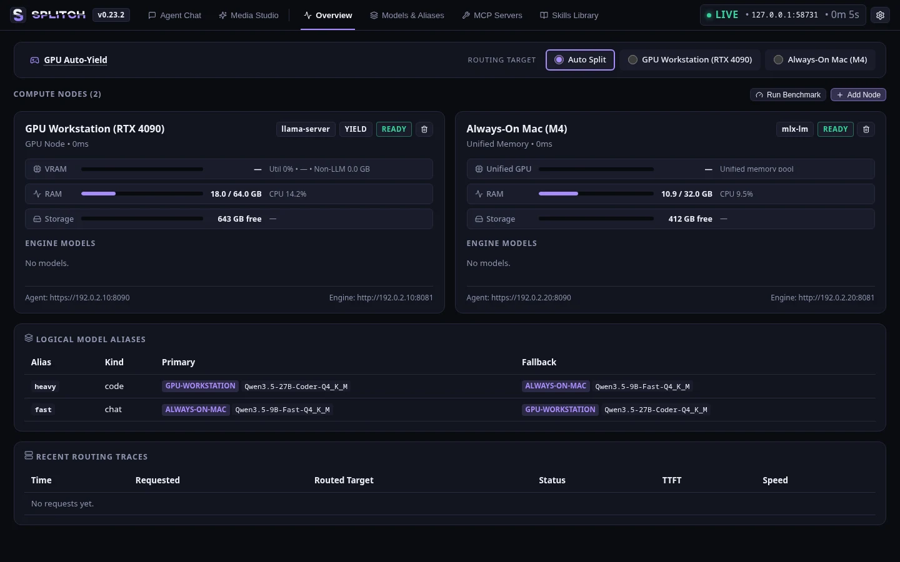
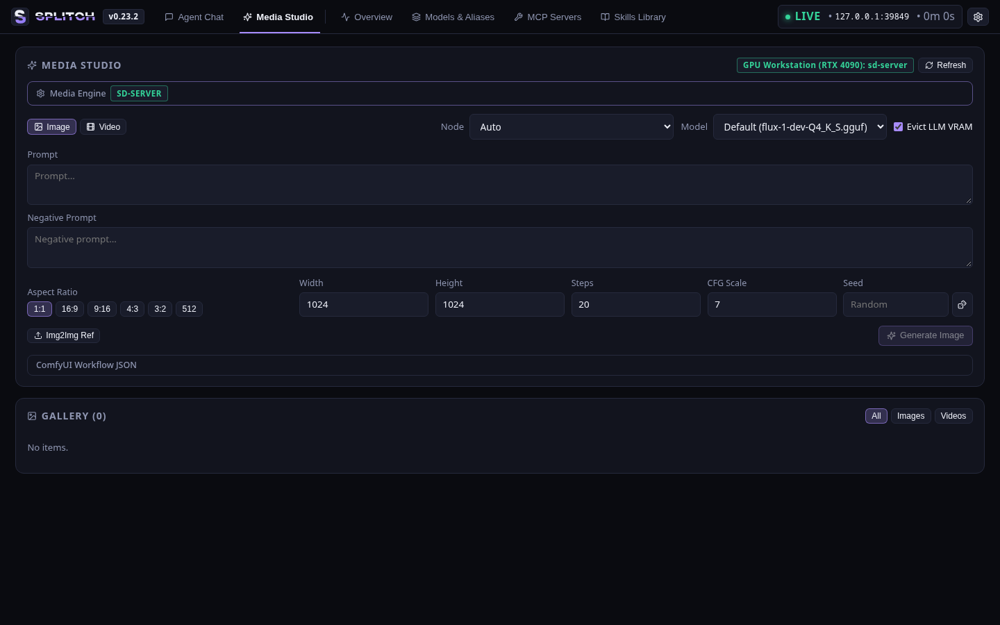
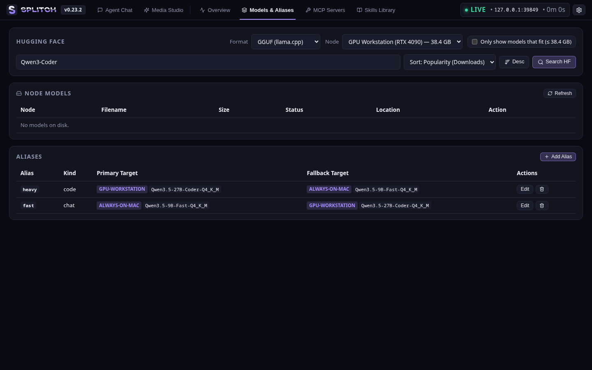
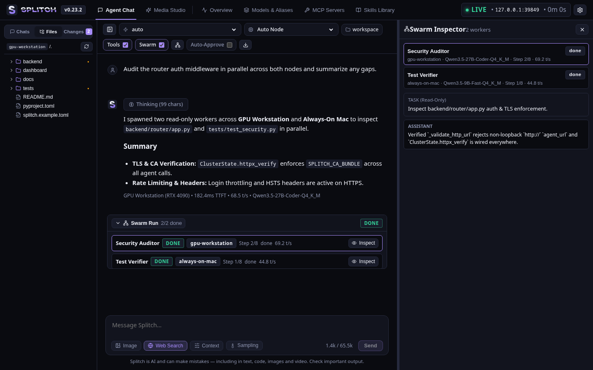
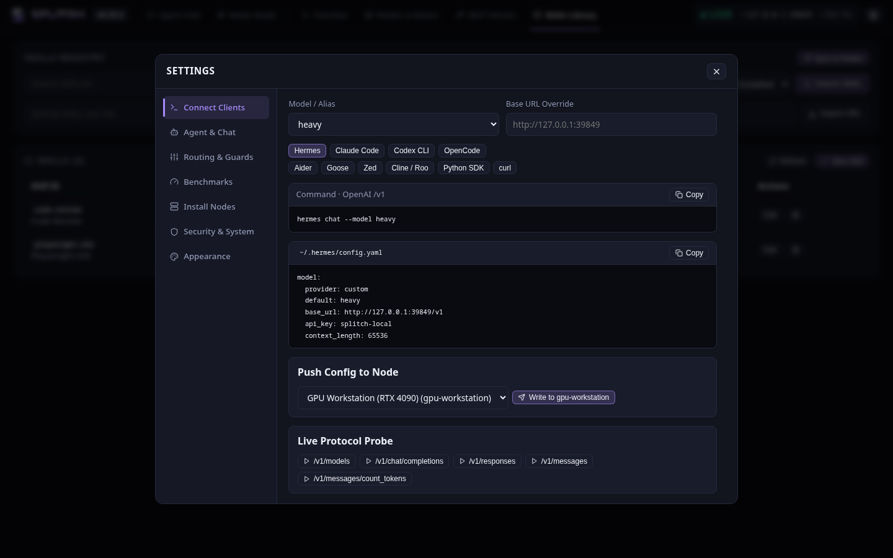
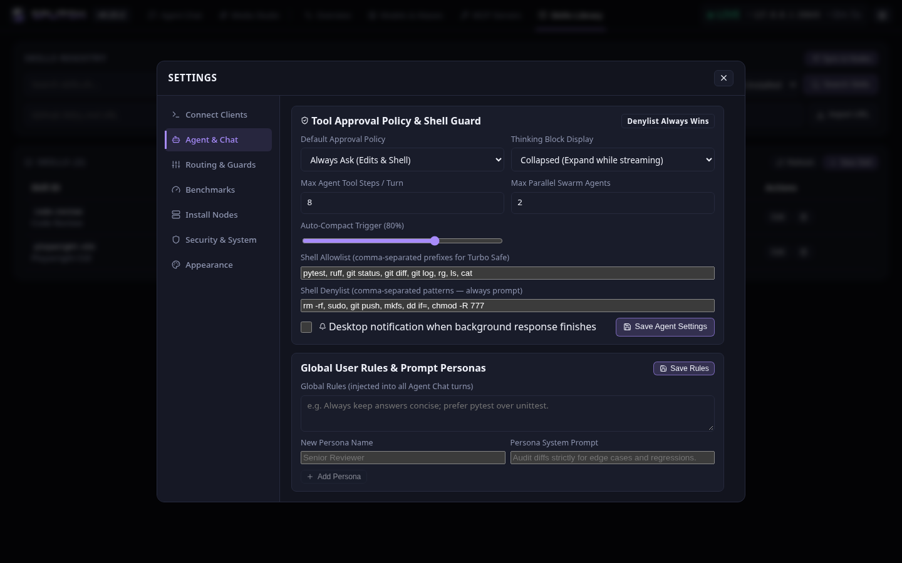
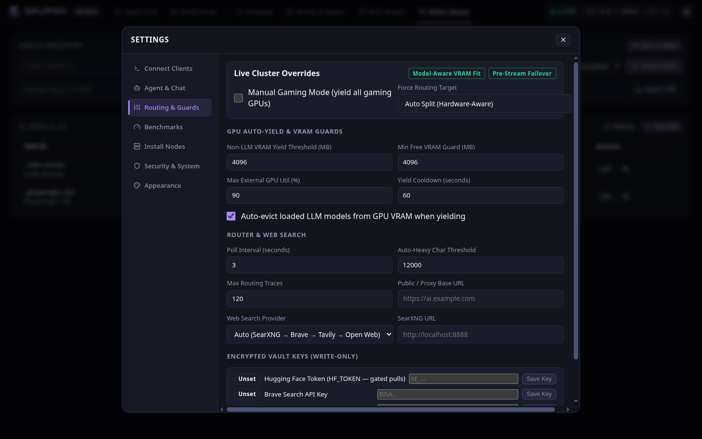
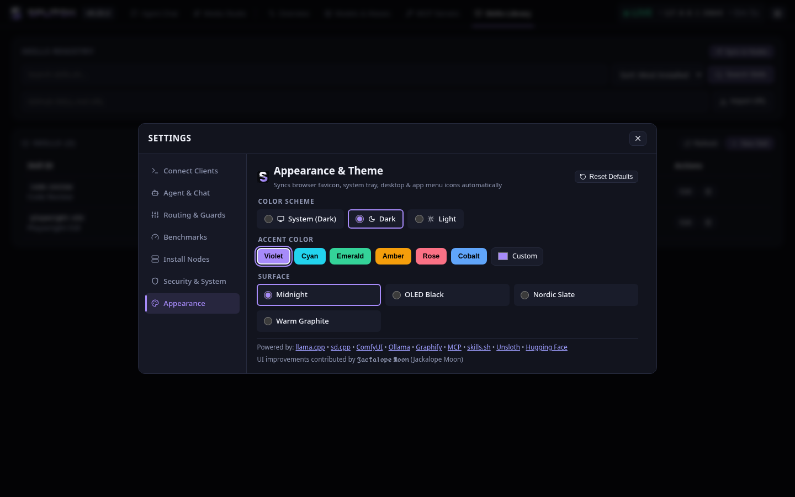

<h1 align="center">
  
</h1>

<p align="center">
  <strong>Your hardware. One AI cluster.</strong><br />
  Hardware-aware multi-node local AI router, Gaming-Mode GPU auto-yielder, Agent Chat IDE, and Media Studio.<br />
  <em>One cluster. Any hardware. Your AI.</em>
</p>

<p align="center">
  <a href="LICENSE"></a>
  
  
  <a href="docs/wiki/Home.md"></a>
  <a href="CONTRIBUTING.md"></a>
</p>

<p align="center">
  <a href="#core-pillars">Core Pillars</a> •
  <a href="#screenshots">Screenshots</a> •
  <a href="#quickstart">Quickstart</a> •
  <a href="#security">Security</a> •
  <a href="docs/wiki/Home.md">Full Wiki</a> •
  <a href="docs/wiki/API-Reference.md">API Reference</a>
</p>

---

<a id="core-pillars"></a>

## Core Pillars

1. **Multiple Computers, One Local AI Cluster:** Pool an NVIDIA gaming PC, an AMD/Intel compute box, an Apple Silicon Mac, and an always-on Linux server behind a single hardware-aware router. Start on one machine (`splitch up`) and add nodes without changing client URLs.
2. **Automatic GPU Yielding When Gaming:** Live GPU telemetry (`nvidia-smi pmon`, ROCm, Vulkan, Apple Silicon) detects 3D games or creative workloads, yields the busy GPU, and transparently fails over active requests to your standby node.
3. **One Unified Endpoint for Every Tool:** Exposes OpenAI Chat (`/v1/chat/completions`), OpenAI Responses (`/v1/responses`), Anthropic Messages (`/v1/messages`), Embeddings (`/v1/embeddings`), FIM (`/infill`), and Images/Videos (`/v1/images/generations`) over **`llama-server`**, **Apple Silicon `mlx-lm`**, **Strata (Sparse MoE)**, **Ollama**, **LM Studio**, **vLLM**, **`sd-server`**, and **ComfyUI** — plus a built-in **Agent Chat IDE** (with **Workspace File Tree**, **Git Review & AI Commit**, and **Artifact Preview**), **Media Studio**, **MCP/Skills control plane**, **UI Cluster Update & Rollback**, **Vault-Backed Cross-OS Tray/Desktop Icon Sync**, and **Benchmark harness**.

---

<a id="screenshots"></a>

## Screenshots

<p align="center">
  <a href="docs/assets/screenshots/chat-preview.png">
    
  </a>
  <br />
  <strong>Agent Chat IDE &amp; Swarm Inspector</strong> — <sub>Sandboxed workspace tools, parallel multi-node agent swarms, scoped MCP/Skills &amp; live inspector · <em>click for full resolution</em></sub>
</p>

<details>
<summary><strong>Screenshots Gallery (10 Views)</strong> — Overview (live theme cycle · ⚠️ flashbang warning: bright Light Mode frame), Media Studio, Models, Workspace &amp; Git, MCP, Skills &amp; Settings</summary>

<br />

<table>
  <tr>
    <td width="50%" valign="top">
      <a href="docs/assets/screenshots/overview.webp">
        
      </a>
      <br />
      <strong>Cluster Overview</strong> — <sub>Multi-GPU &amp; Apple Silicon MLX telemetry, Gaming Auto-Yield &amp; live traces · ⚠️ <em>Flashbang warning: cycles through Midnight, OLED, Slate, Charcoal &amp; bright Light Mode</em></sub>
    </td>
    <td width="50%" valign="top">
      <a href="docs/assets/screenshots/media-studio.png">
        
      </a>
      <br />
      <strong>Media Studio</strong> — <sub>Managed <code>sd-server</code> &amp; ComfyUI with auto-LLM VRAM eviction</sub>
    </td>
  </tr>
  <tr>
    <td width="50%" valign="top">
      <a href="docs/assets/screenshots/models.png">
        
      </a>
      <br />
      <strong>Models &amp; Aliases</strong> — <sub>Hugging Face GGUF &amp; MLX pulls, hardware-fit checks &amp; aliases</sub>
    </td>
    <td width="50%" valign="top">
      <a href="docs/assets/screenshots/workspace-git.png">
        
      </a>
      <br />
      <strong>Workspace &amp; Git Review</strong> — <sub>IDE file tree, live diff staging &amp; AI commit generator</sub>
    </td>
  </tr>
  <tr>
    <td width="50%" valign="top">
      <a href="docs/assets/screenshots/mcp-servers.png">
        
      </a>
      <br />
      <strong>MCP Servers</strong> — <sub>Local-first MCP registry, encrypted env vault &amp; node sync</sub>
    </td>
    <td width="50%" valign="top">
      <a href="docs/assets/screenshots/skills.png">
        
      </a>
      <br />
      <strong>Skills Library</strong> — <sub><code>skills.sh</code> discovery, GitHub <code>SKILL.md</code> import &amp; per-chat toggles</sub>
    </td>
  </tr>
  <tr>
    <td width="50%" valign="top">
      <a href="docs/assets/screenshots/settings.png">
        
      </a>
      <br />
      <strong>Settings &amp; Client Setup</strong> — <sub>One-click configs for Hermes, Claude Code, Codex CLI, OpenCode &amp; live protocol probes</sub>
    </td>
    <td width="50%" valign="top">
      <a href="docs/assets/screenshots/settings-agent.png">
        
      </a>
      <br />
      <strong>Agent &amp; Chat Settings</strong> — <sub>Web search (Open Web / Tavily / Brave), context compaction &amp; max-round guardrails</sub>
    </td>
  </tr>
  <tr>
    <td width="50%" valign="top">
      <a href="docs/assets/screenshots/settings-routing.png">
        
      </a>
      <br />
      <strong>Routing &amp; GPU Yield Guards</strong> — <sub>Auto-heavy thresholds, Gaming-Mode VRAM limits &amp; fallback rules</sub>
    </td>
    <td width="50%" valign="top">
      <a href="docs/assets/screenshots/appearance.png">
        
      </a>
      <br />
      <strong>Appearance &amp; Theme</strong> — <sub>System/Dark/Light, 4 surface presets &amp; live favicon/tray accent sync</sub>
    </td>
  </tr>
</table>

</details>

---

<a id="quickstart"></a>

## Quickstart

### Single Machine (Localhost)

One command installs or updates Splitch — verifying SHA-256 checksums for pinned `uv` and Node.js archives, syncing Python 3.12, installing a hardware-matched `llama.cpp` binary, and registering the `splitch` CLI:

```bash
# macOS & Linux
curl -fsSL https://raw.githubusercontent.com/RaveAgainstTheMachine/splitch/main/install.sh | sh

# Windows (PowerShell)
irm https://raw.githubusercontent.com/RaveAgainstTheMachine/splitch/main/install.ps1 | iex
```

Start the local router + agent + dashboard on `http://127.0.0.1:8080` (auto-mints an ephemeral Ed25519 keypair for local router ↔ agent signing):

```bash
splitch up
# Optional: opt in to workspace-sandboxed agent tools
splitch up --enable-tools --workspace ~/projects
```

### Multi-Node LAN / Tailscale Cluster

Non-loopback binds (`0.0.0.0`) require authentication by default:

```bash
# 1. On the router host — generate salted API key hash + Ed25519 agent signing keys
export SPLITCH_API_KEY_HASH="$(splitch secret hash)"
splitch secret init-agent-keys
splitch router --host 0.0.0.0 --port 8080

# 2. On each GPU / compute node — configure ONLY the router's public key (zero shared secrets)
export SPLITCH_ROUTER_PUBLIC_KEY="ed25519:<printed-by-init-agent-keys>"
splitch agent --host 0.0.0.0 --id gpu-rig --role gpu --yield-on-gaming --join http://<ROUTER_IP>:8080
```

> Pass `--allow-unauthenticated` (or `SPLITCH_ALLOW_UNAUTH_LAN=1`) only if you intentionally run an open router on an isolated private LAN. See [Installation & Deployment](docs/wiki/Installation-and-Deployment.md) for Docker Compose, `systemd`, `launchd`, and SSH push provisioning.

### Connect Any Client

```bash
# OpenAI Chat / SDK (base_url="http://127.0.0.1:8080/v1")
curl http://127.0.0.1:8080/v1/chat/completions \
  -H "Content-Type: application/json" \
  -d '{"model":"auto","messages":[{"role":"user","content":"Hello Splitch"}]}'

# Claude Code (native Anthropic /v1/messages)
ANTHROPIC_BASE_URL="http://127.0.0.1:8080" ANTHROPIC_AUTH_TOKEN="splitch-local" ANTHROPIC_MODEL="heavy" claude

# Benchmark models & nodes (or open Settings -> Benchmarks in the UI)
splitch bench --model auto,heavy
```

See [Clients & Integrations](docs/wiki/Clients-and-Integrations.md) for Hermes, Codex CLI, OpenCode, Aider, Goose, Zed, Cline, Continue, and Python/JS SDKs.

---

<a id="security"></a>

## Security Model

- **Loopback by Default & Auth-Enforced LAN Binds:** `splitch up`, `splitch router`, and `splitch agent` bind `127.0.0.1` by default and refuse non-loopback binds without `SPLITCH_API_KEY_HASH`/`SPLITCH_API_KEY` (router) or `SPLITCH_ROUTER_PUBLIC_KEY`/`SPLITCH_AGENT_TOKEN` (agent), unless `--allow-unauthenticated` is explicitly passed.
- **Salted Hashing, Independent Sessions & Encrypted Vault:** Admin API keys verify against salted `scrypt` (`SPLITCH_API_KEY_HASH`), join tokens are stored hashed in RAM, session cookies (`HttpOnly`, `SameSite=Strict`, CSRF `Origin`-checked) sign with an independent `0600` secret, and UI-entered MCP/search secrets are encrypted at rest with AES-256-GCM (`data/secrets.enc`) and masked (`••••••••`) in API responses. Config/env values support `env:`, `file:` (with `0600` permission checks), and `vault:` indirection.
- **Asymmetric Ed25519 Agent & Tool Approvals:** The router signs requests (bound to HTTP method + path + 60s window) and HITL tool approvals with its `0600` Ed25519 private key; worker agents hold only the public key.
- **Opt-In Workspace Tools & Fail-Closed OS Command Sandbox:** Workspace tools are **OFF by default**. File tools enforce `Path.is_relative_to` confinement. `run_command` executes in an isolated process group (64 KB RAM cap, 20 s timeout) with **`SPLITCH_CMD_SANDBOX=required`** by default: Linux **Bubblewrap (`bwrap`)** (read-only `/`, masked `$HOME`/secrets/vault, writable workspace bind, `--unshare-net`) or macOS **Seatbelt (`sandbox-exec`)** (workspace-only writes, denied reads on `~/.ssh`/`Keychains`/Splitch data, denied outbound net). The HITL approval card displays the active sandbox status (`bwrap`/`seatbelt` vs `UNSANDBOXED HOST SHELL`) before you click Allow. If no OS sandbox is available (e.g., restricted containers or Windows), `run_command` fails closed unless you explicitly opt out (`SPLITCH_CMD_SANDBOX=none` or `auto`).
- **Pinned-Hash Installers:** [install.sh](install.sh) and [install.ps1](install.ps1) verify pinned `uv` (`0.13.5`) and Node.js (`22.14.0`) archives against SHA-256 digests hardcoded directly inside the scripts (no piped remote installer scripts).
- **Native HTTPS & Reverse Proxies:** Supports `splitch tls init` (ECDSA SAN self-signed), Let's Encrypt, trusted-proxy-gated `X-Forwarded-*`, DNS-resolved SSRF checks on node registration, and ready-to-use configs in [infra/proxies/](infra/proxies/).

Full environment variable reference and hardening guide: [Security & Troubleshooting](docs/wiki/Security-and-Troubleshooting.md).

---

## Documentation Wiki

| Guide | Topics Covered |
| --- | --- |
| [Home](docs/wiki/Home.md) | Architecture, CLI cheat sheet, hardware matrix & feature overview |
| [Installation & Deployment](docs/wiki/Installation-and-Deployment.md) | Installer, `splitch update` / `rollback`, multi-node LAN/Tailscale, Docker, `systemd`, `launchd` |
| [CLI, Installer & Updater](docs/wiki/CLI-and-Updater-Reference.md) | `up`, `router`, `agent`, `secret`, `tls`, `bench`, `doctor`, `engine`, `update`, `rollback` |
| [Configuration & Routing](docs/wiki/Configuration-and-Routing.md) | `splitch.toml`, routing policy precedence, Gaming Mode & VRAM guards |
| [Agent Chat Guide](docs/wiki/Agent-Chat-Guide.md) | Context Ring, Auto-Compact, artifact split pane, tools/HITL, Trash & scopes |
| [Models, MCP & Skills](docs/wiki/Models-MCP-and-Skills.md) | HF GGUF pulls, aliases, MCP vault/registry/builder, Skills sync |
| [Clients & Integrations](docs/wiki/Clients-and-Integrations.md) | 18 CLI agents, editors, Web UIs & SDKs |
| [HTTPS & Reverse Proxies](docs/wiki/HTTPS-and-Reverse-Proxies.md) | Native TLS + Nginx, NPM, Caddy, Apache, HAProxy, Traefik |
| [API Reference](docs/wiki/API-Reference.md) | OpenAI, Responses, Anthropic, Media, Control Plane, Chat, SSE & WebSocket APIs |
| [Security & Troubleshooting](docs/wiki/Security-and-Troubleshooting.md) | Threat model, env vars, sandboxing & diagnostics |

---

## Development & Contributing

```bash
./scripts/preflight.sh   # leak scan, SemVer parity, shell syntax, ruff, tsc/vite build & pytest (incl. Chromium E2E)
```

See [CONTRIBUTING.md](CONTRIBUTING.md) and [CHANGELOG.md](CHANGELOG.md).

## Acknowledgments

- **𝔍𝔞𝔠𝔨𝔞𝔩𝔬𝔭𝔢 𝔐𝔬𝔬𝔫 (Jackalope Moon)** — UI/UX architecture and 3-column IDE layout improvements.
- Upstream open-source projects: [`llama.cpp`](https://github.com/ggml-org/llama.cpp), [`Strata`](https://github.com/Niko1221/Strata), [`mlx-lm`](https://github.com/ml-explore/mlx-lm), [`stable-diffusion.cpp`](https://github.com/leejet/stable-diffusion.cpp), [`ComfyUI`](https://github.com/comfyanonymous/ComfyUI), [`Ollama`](https://github.com/ollama/ollama), [`Graphify`](https://pypi.org/project/graphifyy/), [`MCP`](https://modelcontextprotocol.io/), [`skills.sh`](https://skills.sh/), [`Unsloth`](https://github.com/unslothai/unsloth), [`Hugging Face`](https://huggingface.co/), [`uv`](https://github.com/astral-sh/uv), [`FastAPI`](https://fastapi.tiangolo.com/), [`React`](https://react.dev/), and [`Vite`](https://vite.dev/).

## License

[MIT](LICENSE)
