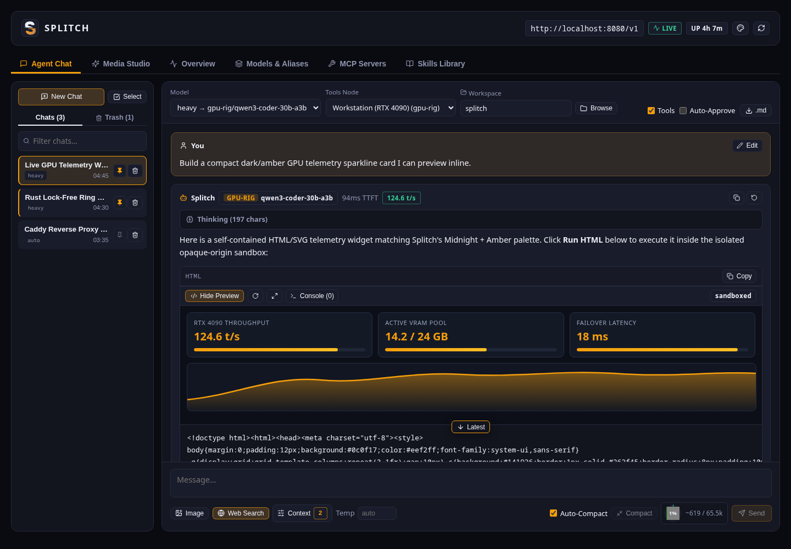
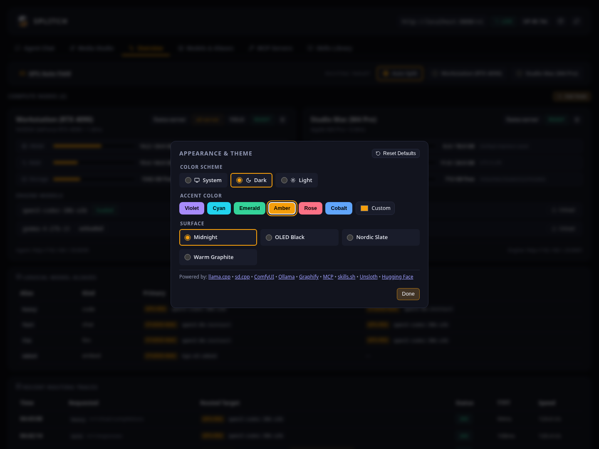

# Agent Chat Guide

Splitch includes a full-featured, local-first **Agent Chat** workspace backed by SQLite WAL — built specifically for the realities of local models (`8k–32k` context windows, multi-node routing, workspace tools, and fast iteration).

---

## 1. Pre-Prompt Configuration & Toolbar

Every control in the chat toolbar is immediately clickable **before** sending your first prompt (draft settings automatically persist when the thread is created):

- **Model:** Choose `auto`, any logical alias (`heavy`, `fast`), or a pinned `<node>/<model>`.
- **Tools Node:** Select which tools-enabled compute node executes workspace tools (`Auto` selects the first online tools-enabled node).
- **Workspace Subpath + Browse:** Scope agent filesystem & shell commands to a specific subfolder inside the node's `SPLITCH_WORKSPACE_ROOT`. Click **Browse** to navigate directories visually without typing paths manually.
- **Tools:** Enable native tool calling (`list_dir`, `read_file`, `grep_search`, `write_file`, `run_command`).
- **Auto-Approve:** When OFF (default), mutating tools (`write_file`, `run_command`) pause execution and display an inline **Allow / Deny** card with a unified diff or exact command preview before running.
- **Context (Sliders icon):** Configure a per-chat **System Prompt**, and assign **Skills** & **MCP Servers** across 3 scopes:
  - **This Chat** — active only in the current conversation.
  - **Project (`<workspace_subpath>`)** — automatically active in every conversation using that project workspace folder.
  - **Global (All Chats)** — automatically active across all conversations in Splitch.
  - Displays `local` vs `ext` privacy badges on every MCP server, shows an **Ext MCP** warning pill in the bottom bar whenever an external/remote MCP is active, and pauses external MCP tool calls for **Allow / Deny** confirmation.
- **Export (`.md`):** Download the entire conversation (including reasoning and tool calls) as a clean Markdown file.

---

## 2. Bottom Composer Bar: Web Search, Context Ring & Compaction

Right beneath the composer sit the live session controls:

### Web Search Toggle
Toggle **Web Search** to expose `web_search` and `web_fetch` tools to the model. Splitch selects the highest-priority configured backend automatically:
1. `SPLITCH_SEARXNG_URL` (self-hosted SearXNG JSON API — private & unlimited)
2. `BRAVE_API_KEY` (Brave Search API)
3. `TAVILY_API_KEY` (Tavily Search API)
4. Zero-key open fallback (DuckDuckGo Instant Answer + Wikipedia API + Hacker News Algolia)

> Every `web_fetch` call enforces an SSRF guard rejecting `localhost`, RFC1918 private LAN IPs, link-local metadata endpoints (`169.254.169.254`), and non-HTTP schemes.

### Context Progress Ring
Displays real-time active token utilization against the active node's `n_ctx` context window (seeded from real upstream `stream_options: {"include_usage": true}` counts plus live composer token delta):
- **Green (< 65%)**, **Amber (65–84%)**, **Red (>= 85%)**.

### Non-Destructive Auto-Compact & Manual Compact
Local models typically run 8k–32k `n_ctx`; multi-round tool calls fill context rapidly. Splitch solves this **without deleting your chat history**:
- **Auto-Compact (ON by default):** When active context crosses **80%**, Splitch automatically summarizes older turns before sending (preferring your `fast` alias if configured), emits live `compacting` / `compacted` SSE indicators, and visibly drops the Context Ring.
- **Manual Compact:** Click **Compact** beside the Context Ring anytime to condense older turns on demand.
- **100% Non-Destructive:** All original messages stay preserved in SQLite and remain visible above a collapsible **Compacted context** summary divider. Click **Clear Summary** to revert to full-history sending anytime. Branching/trimming a message before the compaction watermark automatically invalidates stale summaries.

---

## 3. Inline Sandboxed Preview ("Run in Place")

Whenever the model outputs a runnable **`html`**, **`htm`**, or **`svg`** fenced code block — or writes an `.html` / `.svg` file via `write_file` — Splitch renders an inline preview toolbar directly beneath the block:

- **Run HTML / Run SVG:** Executes the code live inside an isolated `<iframe sandbox="allow-scripts">` right inside the chat thread (try asking: *"Build a single-file HTML/JS Hangman game"*).
- **Reload:** Cleanly resets the sandbox state and clears logs.
- **Fullscreen:** Opens the live preview inside a large native `<dialog>` modal.
- **Console (N):** Captures `console.log`, `console.warn`, `console.error`, runtime exceptions, and unhandled promise rejections from inside the sandbox.

> **Security:** Preview iframes never receive `allow-same-origin`, enforce `connect-src 'none'` via CSP (no access to Splitch's API or local network), send `referrerPolicy="no-referrer"`, disable focus-stealing (`focus-without-user-activation 'none'`), and validate `postMessage` frames via opaque origin pinning (`Origin.from(event)` / `event.source`).

---

## 4. Organizing Chats: Pinning, Multi-Select Bulk Delete & Trash Bin

- **Pin to Top:** Click the **Pin** icon on any conversation in the sidebar to keep important threads anchored at the top. Unpinning preserves the original `updated_at` timestamp so the thread returns smoothly to its exact chronological slot.
- **Multi-Select Bulk Actions:** Click **Select** next to **New Chat** (press `Esc` or **Done** to exit):
  - Check individual threads, toggle **All** (tri-state checkbox respects active search filter), or **`Shift+Click`** to select a contiguous range in one click.
  - In **Chats:** Click **Delete (N)** to confirm and move all selected threads to Trash.
  - In **Trash:** Click **Restore (N)** or **Erase (N)** (permanent delete with confirmation).
- **Recoverable Trash Bin:** Single and bulk deletes are soft-deletes. Switch to the **Trash** tab in the sidebar to recover any deleted chat, permanently erase individual/selected chats, or **Empty Trash**.
- **Scroll-to-Bottom & Latest Pill:** Opening any conversation jumps straight to the newest message while respecting manual upward scrolling — a floating **↓ Latest** pill appears whenever you scroll up.
- **Edit / Branch & Regenerate:** Hover or click **Edit** on any prior user turn to revise and re-run from that point, or **Regenerate** on an assistant turn.

---

## 5. Appearance & Theme Customization

Click the **Palette** icon in the top-right header bar to customize Splitch's appearance (persisted in `localStorage` with zero flash-of-unstyled-content on reload):
- **Color Mode:** System, Dark, or Light.
- **Accent Color:** 6 curated presets (Violet, Cyan, Emerald, Amber, Rose, Cobalt) or any custom color via the native color picker.
- **Dark Surface Palette:** Midnight, OLED Black, Nordic Slate, or Warm Graphite.

---

Next: **[Models, MCP & Skills →](Models-MCP-and-Skills.md)**
