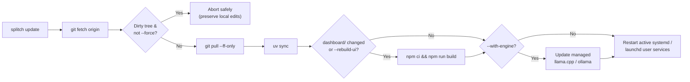

# CLI, Installer & Updater Reference

Splitch provides a unified CLI (`splitch`) and cross-platform 1-line installers ([install.sh](../../install.sh) and [install.ps1](../../install.ps1)) that handle dependency bootstrapping, environment diagnostics, and safe in-place updates.

---

## 1. Universal Installers (`install.sh` & `install.ps1`)

Re-running the installer on an existing machine updates Splitch in place without touching your `splitch.toml`, SQLite chat history, skills, MCP registry, or downloaded GGUF models.

### What the Installer Bootstraps Automatically
1. **Hardware & Engine Probe:** Detects Linux/macOS/WSL/Windows, CPU architecture (`x64`/`arm64`), GPU (`nvidia-smi` + driver CUDA version, `rocm-smi`, Apple Silicon Metal, Vulkan, or CPU), and existing `llama-server` / `ollama` binaries.
2. **`uv` + Isolated Python 3.12:** Installs [`uv`](https://docs.astral.sh/uv/) if missing and provisions an isolated `.venv` without requiring system Python upgrades or `sudo`.
3. **Standalone Node.js 22 LTS (Router Installs Only):** If `node >= 20` is missing and `--agent-only` is not set, downloads an isolated standalone Node.js runtime into `~/.local/share/splitch/node` (or `%LOCALAPPDATA%\splitch\node` on Windows) with zero system-wide modifications.
4. **Hardware-Matched Inference Engine (`--engine auto|llama.cpp|ollama|none`):** Automatically downloads & atomically installs the optimal prebuilt `ggml-org/llama.cpp` release (`llama-server` + matching `cudart` runtime on CUDA, ROCm, Metal, Vulkan, or CPU) into `<data_root>/engines/llama.cpp` with a library-safe shim (`~/.local/bin/llama-server`) if no engine is present — or updates your Splitch-managed engine on re-run. Pass `--engine ollama` to install/update Ollama or `--engine none` to skip.
5. **Dashboard Build & Global Shim:** Builds `dashboard/dist`, installs `~/.local/bin/splitch` (or `%LOCALAPPDATA%\splitch\bin\splitch.cmd`), and writes `install_meta.json` + `engine_meta.json` under your Splitch data root.

### Installer Flags & Environment Overrides

| POSIX Flag (`install.sh`) | PowerShell Flag (`install.ps1`) | Env Override | Default | Purpose |
| --- | --- | --- | --- | --- |
| `--local` | `-Local` | `SPLITCH_LOCAL=1` | `0` | Install/update in place using the current git checkout |
| `--agent-only` | `-AgentOnly` | `SPLITCH_AGENT_ONLY=1` | `0` | Skip Node.js & dashboard UI build (ideal for GPU workers) |
| `--no-ui-build` | `-NoUiBuild` | `SPLITCH_NO_UI_BUILD=1` | `0` | Skip Vite dashboard rebuild |
| `--engine <target>` | `-Engine <target>` | `SPLITCH_ENGINE` | `auto` | Inference backend: `auto`, `llama.cpp`, `ollama`, or `none` |
| `--backend <accel>` | `-Backend <accel>` | `SPLITCH_ENGINE_BACKEND` | `auto` | Accelerator override: `auto`, `cuda`, `rocm`, `vulkan`, `metal`, `cpu` |
| `--with-media` | `-WithMedia` | `SPLITCH_WITH_MEDIA=1` | `0` | Also install/update managed `stable-diffusion.cpp` (`sd-server`) for Media Studio |
| `--dir <path>` | `-Dir <path>` | `SPLITCH_HOME` | `<data_root>/app` | Target managed installation directory |
| `--bin-dir <path>` | *(fixed `<data_root>\bin`)* | `SPLITCH_BIN_DIR` | `~/.local/bin` | Global `splitch` & `llama-server` shim directory |
| `--repo <url>` | `-Repo <url>` | `SPLITCH_REPO` | GitHub repo URL | Source git repository URL |
| `--branch <name>` | `-Branch <name>` | `SPLITCH_BRANCH` | `main` | Git branch or ref to track |
| `--python <ver>` | `-Python <ver>` | `SPLITCH_PYTHON` | `3.12` | Python version managed by `uv` |
| `--no-desktop` | `-NoDesktop` | `SPLITCH_NO_DESKTOP=1` | `0` | Skip Desktop / Application Menu shortcuts and system tray dependencies |
| `--join <url>` | `-Join <url>` | `SPLITCH_JOIN_URL` | *(none)* | Auto-register installed agent with a cluster router |
| `--join-token <tok>` | `-JoinToken <tok>` | `SPLITCH_JOIN_TOKEN` | *(none)* | Single-use `spj_*` join token for `--join` |
| `--uninstall` | `-Uninstall` | — | — | Stop services/tray and remove CLI shims, shortcuts, managed app & engines |
| `--purge` | `-Purge` | — | — | With uninstall, also erase user chats, skills, and models |

---

## 2. `splitch` CLI Subcommands

### `splitch up` — Single-Machine Zero-Config Launch
Launches both a local `splitch-agent` and `splitch-router` + Web UI in one command:

```bash
splitch up [options]
```

| Flag | Default | Description |
| --- | --- | --- |
| `--host` | `0.0.0.0` | Router bind address |
| `--port` | `8080` | Router HTTP & dashboard port |
| `--agent-port` | `8090` | Local agent port |
| `--engine-url` | auto-detect | Inference engine URL (`:8081`, `:11434`, `:1234`, `:8000`) |
| `--config` | auto-discover | Explicit `splitch.toml` path |
| `--enable-tools` | off | Opt in to sandboxed Agent Chat workspace tools |
| `--workspace` | `$HOME` | Allowed root directory for workspace tools |

### `splitch router` — Run Router & Dashboard Only

```bash
splitch router [--config splitch.toml] [--host 0.0.0.0] [--port 8080]
```

### `splitch agent` — Run Node Telemetry, Pull & Tools Agent

```bash
splitch agent \
  --id gpu-rig \
  --name "GPU Workstation" \
  --role gpu \
  --yield-on-gaming \
  --engine-url http://127.0.0.1:8081 \
  --storage-path /srv/models \
  --enable-tools \
  --workspace ~/projects \
  --advertise-host 192.168.1.50 \
  --join http://192.168.1.10:8080
```

| Flag | Default | Description |
| --- | --- | --- |
| `--id` | `SPLITCH_NODE_ID` or hostname | Lowercase node slug |
| `--name` | hostname | Human-friendly node display name |
| `--role` | `SPLITCH_NODE_ROLE` or auto | `gpu`, `unified`, or `cpu` |
| `--yield-on-gaming` | off | Yield this node whenever Gaming Mode or VRAM guards trigger |
| `--host` / `--port` | `0.0.0.0` / `8090` | Agent listen address & port |
| `--engine-url` | `SPLITCH_ENGINE_URL` or auto | Local inference backend URL |
| `--media-url` | `SPLITCH_MEDIA_URL` or auto | Optional local `sd-server` (`:8082`) or `ComfyUI` (`:8188`) URL |
| `--storage-path` | `~/.local/share/splitch/models` | Managed GGUF storage directory |
| `--enable-tools` | off | Opt in to sandboxed workspace tools (`SPLITCH_ENABLE_TOOLS=1`) |
| `--workspace` | `$HOME` | Workspace sandbox root (`SPLITCH_WORKSPACE_ROOT`) |
| `--join` | *(none)* | Router URL to register this node with on startup |
| `--advertise-host` | auto LAN IP | Explicit LAN or Tailscale IP advertised when using `--join` |

### `splitch init` — Generate Starter `splitch.toml`

```bash
splitch init [--output splitch.toml] [--engine-url http://127.0.0.1:8081] [--force]
```

### `splitch doctor` — Environment, Hardware & Engine Diagnostics

```bash
splitch doctor                       # human-readable table with fix hints
splitch doctor --check-updates       # also compare installed llama-server build against GitHub releases
splitch doctor --fix                 # auto-install/update missing LLM engine and rebuild missing dashboard
splitch doctor --fix --with-media    # also install/update managed stable-diffusion.cpp (`sd-server`)
splitch doctor --json                # structured JSON (same schema as GET /api/system/doctor)
```

Audits 11 dimensions:
1. **python** — Python `>= 3.11` runtime path
2. **uv** — `uv` CLI version & path
3. **git** — Branch, short SHA, clean/dirty tree state
4. **nodejs** — System or managed standalone Node.js `>= 20` & `npm`
5. **dashboard_dist** — Built `dashboard/dist/index.html` presence
6. **accelerator** — NVIDIA CUDA (`nvidia-smi`), AMD ROCm (`rocm-smi`), Apple Silicon Metal, or CPU-only
7. **engine_binary** — Managed & system `llama-server` / `ollama` / `sd-server` binaries, parsed build tags, and upstream update status
8. **local_engine** — Reachability probe across `:8081`, `:11434`, `:1234`, `:8000`
9. **media_engine** — Reachability probe across `:8082` (`sd-server`) and `:8188` (`ComfyUI`) + managed binary status
10. **data_dir** — Write permissions & SQLite conversation count
11. **security** — Active status of `SPLITCH_API_KEY`, `SPLITCH_AGENT_TOKEN`, and `SPLITCH_ENABLE_TOOLS`

### `splitch engine` — Install, Inspect & Update Inference & Media Engines

```bash
# Inspect detected GPU backend, installed engines, and latest upstream llama.cpp asset
splitch engine status --check-remote

# Dry-run: preview exact prebuilt archive + CUDA runtime asset without downloading
splitch engine install llama.cpp --dry-run
splitch engine install sd.cpp --dry-run

# Atomically install or upgrade managed llama.cpp or stable-diffusion.cpp (`sd-server`)
splitch engine install llama.cpp --backend auto
splitch engine install sd.cpp --backend auto
splitch engine update llama.cpp
splitch engine update sd.cpp

# Install or update Ollama via official installer / Homebrew / winget
splitch engine install ollama
```

### `splitch update` — Safe Self-Updater



```bash
splitch update --check                   # dry-run: show Splitch & engine updates without modifying files
splitch update                           # pull + uv sync + conditional UI rebuild + service restart
splitch update --with-engine             # update Splitch AND managed inference engine together
splitch update --agent-only              # skip UI rebuild on headless worker nodes
splitch update --rebuild-ui              # force dashboard rebuild even if unchanged
splitch update --no-restart              # skip automatic systemd / launchd restart
splitch update --branch main --force     # override branch or bypass dirty-tree guard
```

### `splitch launch`, `splitch tray`, `splitch stop` & `splitch desktop` — Desktop Launcher & Universal System Tray

Splitch includes native OS desktop integration and a zero-polling (`/ws/status` WebSocket) system tray across Linux (StatusNotifierItem + `com.canonical.dbusmenu` for Wayland/X11 compositors + `pystray` XEmbed fallback), macOS (`NSStatusBar`), and Windows (`Shell_NotifyIcon`):

```bash
# Start Splitch if offline (systemd user service or detached router), start system tray, and open Web UI
splitch launch [--url http://localhost:8080] [--no-tray] [--no-browser]

# Run the system tray icon daemon (foreground or --detach)
splitch tray [--url http://localhost:8080] [--detach]

# Gracefully stop managed Splitch router/agent processes and system tray
splitch stop [--keep-tray]

# Install, inspect, or remove Application Menu / Start Menu / Desktop shortcuts & login autostart
splitch desktop install [--autostart] [--no-desktop-icon] [--url http://localhost:8080] [--mode local|remote] [--service splitch-agent.service]
splitch desktop status [--json]
splitch desktop check-updates
splitch desktop uninstall
```

### `splitch version`

```bash
splitch version
```

---

Next: **[Configuration & Routing →](Configuration-and-Routing.md)**
