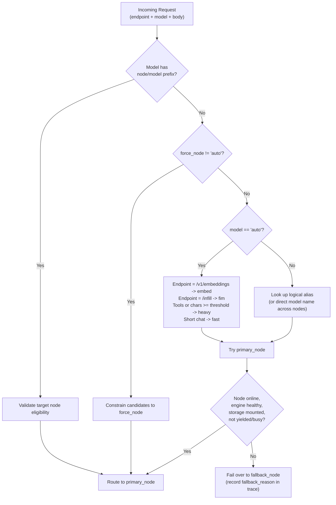

# Configuration & Routing

Splitch can run with **zero configuration** (`splitch up`) or be configured declaratively via `splitch.toml`, environment variables, and live dashboard overrides.

---

## 1. Config File Discovery Order

When `splitch-router` starts, `backend/router/config.py` resolves configuration in this order:

1. Explicit `SPLITCH_CONFIG` environment variable (or `--config` CLI flag).
2. `./splitch.local.toml` (gitignored personal override — ideal if you track a public fork).
3. `./splitch.toml`
4. `~/.config/splitch/splitch.toml`
5. Zero-config fallback: auto-creates a single local node (`127.0.0.1:8090` + auto-detected engine).

Dynamic nodes added via `splitch agent --join` or **Overview → + Add Node**, along with edited aliases and Gaming-Mode state, persist under `SPLITCH_DATA_DIR` (`~/.local/share/splitch/data`).

---

## 2. Annotated `splitch.toml`

```toml
[router]
host = "0.0.0.0"
port = 8080
poll_interval_s = 3.0              # Telemetry poll cadence per node
max_traces = 120                   # In-memory routing trace ring buffer
auto_heavy_char_threshold = 12000  # Prompt length above which `auto` prefers `heavy`
state_file = ".splitch_state.json" # Persisted Gaming Mode & force_node state
public_url = ""                    # Optional reverse-proxy external URL
approval_policy = "ask"            # "ask" | "auto_edits" | "turbo_safe" | "full_auto"
max_agent_steps = 8                # Max tool-calling rounds per user turn (1..32)
auto_compact_threshold = 0.80      # Context utilization ratio triggering auto-compaction
thinking_display = "collapsed"     # "collapsed" | "expanded" | "hidden"

[guards]
# Yield discrete-GPU nodes automatically when non-LLM VRAM (games, Blender, etc.) exceeds this
non_llm_vram_threshold_mb = 4096
# Minimum free VRAM required on a discrete-GPU node to cold-load an unloaded model
min_vram_free_mb = 4096
# If GPU util exceeds this while Splitch has 0 in-flight requests, treat GPU as busy externally
max_external_gpu_util_percent = 90.0
# Keep GPU yielded for 60s after external game VRAM/load drops so menu/loading dips don't reload a heavy LLM
yield_cooldown_s = 60.0
# Automatically unload loaded LLM models from GPU VRAM when external game/3D load is detected
auto_evict_on_yield = true

[[nodes]]
id = "gpu-rig"
display_name = "GPU Workstation"
role = "gpu"                       # "gpu" | "unified" | "cpu"
yield_on_gaming = true             # Auto-evict GPU models & fail over when game VRAM/load triggers
# yield_gpu_indices = [0]          # Optional: monitor only specific GPU indices on multi-GPU rigs
agent_url = "http://192.168.1.50:8090"
engine_url = "http://192.168.1.50:8081" # Primary engine; managed Strata sidecar (:8085) is auto-proxied via agent_url
media_url = ""                     # Optional override (auto-detects sd-server :8082 / ComfyUI :8188)
storage_path = "/srv/models"

[[nodes]]
id = "always-on"
display_name = "Always-On Mac Mini"
role = "unified"                   # Supports llama-server, managed mlx-lm (:8081), or Strata
yield_on_gaming = false
agent_url = "http://127.0.0.1:8090"
engine_url = "http://127.0.0.1:8081"
storage_path = "/Volumes/Models"

[[aliases]]
alias = "heavy"
task_kind = "code"                 # "code" | "chat" | "fim" | "embed" | "image" | "video"
primary_node = "gpu-rig"
primary_model = "qwen3-coder-30b-a3b"
fallback_node = "always-on"
fallback_model = "qwen3-8b-fast"

[[aliases]]
alias = "fast"
task_kind = "chat"
primary_node = "always-on"
primary_model = "qwen3-8b-fast"    # Or MLX repo ID e.g. "mlx-community/Qwen2.5-Coder-7B-Instruct-4bit"
fallback_node = "gpu-rig"
fallback_model = "qwen3-coder-30b-a3b"

[[aliases]]
alias = "embed"
task_kind = "embed"
primary_node = "always-on"
primary_model = "bge-small-en-v1.5"
fallback_node = "gpu-rig"
fallback_model = "bge-small-en-v1.5"

# Optional: Strata Sparse-MoE sidecar (:8085) & Media Studio aliases
# [[aliases]]
# alias = "moe"
# task_kind = "chat"
# primary_node = "gpu-rig"
# primary_model = "Qwen3.8-Flash-Next-IQ2_XS"
# fallback_node = "always-on"
# fallback_model = "qwen3-8b-fast"
#
# [[aliases]]
# alias = "image-fast"
# task_kind = "image"
# primary_node = "gpu-rig"
# primary_model = "z_image_turbo-Q4_K_M.gguf"
```

---

## 3. Routing Policy Decision Tree

Every request to `/v1/chat/completions`, `/v1/completions`, `/v1/embeddings`, `/infill`, or Agent Chat flows through `resolve_route()` in `backend/router/policy.py`:



### How `auto` Classifies Requests
1. **`/v1/embeddings`** → selects the `embed` alias (or first embedding-capable node).
2. **`/infill`** → selects the `fim` alias (falling back to `fast` / `heavy`).
3. **Tool-calling requests** (`tools` array non-empty) or prompts with total character length >= `auto_heavy_char_threshold` (default `12000`) → prefers `heavy`.
4. **Short conversational prompts** → prefers `fast` for snappy TTFT without waking a heavy GPU model unnecessarily.
5. **Single-node / zero-config clusters** → automatically routes to the first healthy model on the online node.

---

## 4. GPU Auto-Yield, Auto-VRAM Eviction & Cooldown Hysteresis

Splitch prevents local LLM workloads from stuttering games or crashing CUDA out-of-memory—with **zero manual toggling required**:

### Automatic Detection + Auto-VRAM Eviction
On discrete-GPU nodes (`role = "gpu"`, `yield_on_gaming = true`), `splitch-agent` inspects live GPU processes every poll interval (`nvidia-smi pmon` on NVIDIA, `rocm-smi` on AMD):
- Processes matching known LLM / diffusion engines (`llama-server`, `ollama`, `vllm`, `strata-server`, `sd-server`, `sd-cli`) are counted as AI VRAM.
- All other GPU consumers (Steam games, Blender, DaVinci Resolve, OBS, etc.) count toward `non_llm_vram_mb`.
- Whenever any guard trips (`non_llm_vram_mb >= non_llm_vram_threshold_mb` or `gpu_util_percent >= max_external_gpu_util_percent` with `0` in-flight requests):
  1. **Auto-VRAM Eviction (`auto_evict_on_yield = true`):** Splitch immediately calls `POST /models/unload` on loaded LLM models (and `POST /strata/stop` if the managed Strata sidecar is active) on that GPU node to hand 100% of VRAM back to your game.
  2. **60-Second Cooldown Hold (`yield_cooldown_s = 60.0`):** Keeps the GPU node yielded (`COOLDOWN`) during brief menu/loading-screen VRAM dips so a 20 GB LLM never reloads mid-game.
  3. **Transparent Failover:** Incoming requests transparently route to your standby node (`always-on`).
- To manually pin all traffic to a specific node anytime, pick it in **Overview → Routing Target** (`Auto Split`, `PC`, `Mac Mini`), or use `POST /api/control {"force_node": "<id>"}`.

### Media Generation VRAM Choreography
When **Media Studio** or Agent Chat runs an image/video generation job on a GPU node with **Auto-Evict LLM VRAM** enabled, Splitch automatically unloads any loaded LLM models on that node before dispatching the diffusion job to `sd-server` or `ComfyUI`, preventing VRAM OOMs.

---

## 5. Complete Environment Variable Reference

| Variable | Component | Default | Purpose |
| --- | --- | --- | --- |
| `SPLITCH_CONFIG` | Router | auto-discover | Explicit path to `splitch.toml` |
| `SPLITCH_DATA_ROOT` | Router & Installer | `~/.local/share/splitch` (`%LOCALAPPDATA%\splitch` on Windows) | Base root for data, skills, models, managed Node.js, and `install_meta.json` |
| `SPLITCH_DATA_DIR` | Router | `<data_root>/data` | SQLite chat DB, aliases, MCP servers, dynamic nodes |
| `SPLITCH_SKILLS_DIR` | Router | `<data_root>/skills` | Canonical `SKILL.md` library directory |
| `SPLITCH_MCP_SCRIPTS_DIR` | Router | `<data_root>/mcp_servers` | Guided Python MCP scripts generated by UI |
| `SPLITCH_API_KEY` | Router | *(unset)* | Optional Bearer / `X-API-Key` secret for `/v1/*`, `/api/*`, `/ws/status` |
| `SPLITCH_AGENT_TOKEN` | Router & Agent | *(unset)* | Shared Bearer secret for router ↔ agent calls |
| `SPLITCH_SEARXNG_URL` | Router | *(unset)* | Self-hosted SearXNG base URL for Agent Chat Web Search |
| `BRAVE_API_KEY` | Router | *(unset)* | Optional Brave Search API key |
| `TAVILY_API_KEY` | Router | *(unset)* | Optional Tavily Search API key |
| `SPLITCH_NODE_ID` | Agent | hostname | Node slug advertised to router |
| `SPLITCH_NODE_ROLE` | Agent | auto | `gpu`, `unified`, or `cpu` |
| `SPLITCH_ENGINE_URL` | Agent | `http://127.0.0.1:8081` | Local inference server URL |
| `SPLITCH_MEDIA_URL` | Agent | auto (`:8082` / `:8188`) | Optional local `sd-server` or `ComfyUI` URL |
| `SPLITCH_JEVERATION_PORT` | Agent | `8084` | Loopback port for managed Jeveration 1-pass CUDA worker |
| `SPLITCH_STORAGE_PATH` | Agent | `<data_root>/models` | Directory scanned & targeted for GGUF & `.safetensors` pulls |
| `SPLITCH_ENABLE_TOOLS` | Agent | `0` | Opt-in flag (`1` enables sandboxed workspace tools) |
| `SPLITCH_WORKSPACE_ROOT` | Agent | `$HOME` | Hard sandbox boundary for workspace tools & folder browser |
| `SPLITCH_AGENT_ONLY` | Installer | `0` | Set to `1` to skip Node.js and dashboard UI build |
| `SPLITCH_ENGINE` | Installer | `auto` | Inference backend to install/update (`auto`, `llama.cpp`, `ollama`, `none`) |
| `SPLITCH_ENGINE_BACKEND` | Installer | `auto` | Engine accelerator override (`auto`, `cuda`, `rocm`, `vulkan`, `metal`, `cpu`) |
| `SPLITCH_WITH_MEDIA` | Installer | `0` | Set to `1` to also install/update managed `sd.cpp` (`sd-server`) |
| `SPLITCH_PYTHON` | Installer | `3.12` | Python version provisioned by `uv` during install |

---

Next: **[Agent Chat Guide →](Agent-Chat-Guide.md)**
