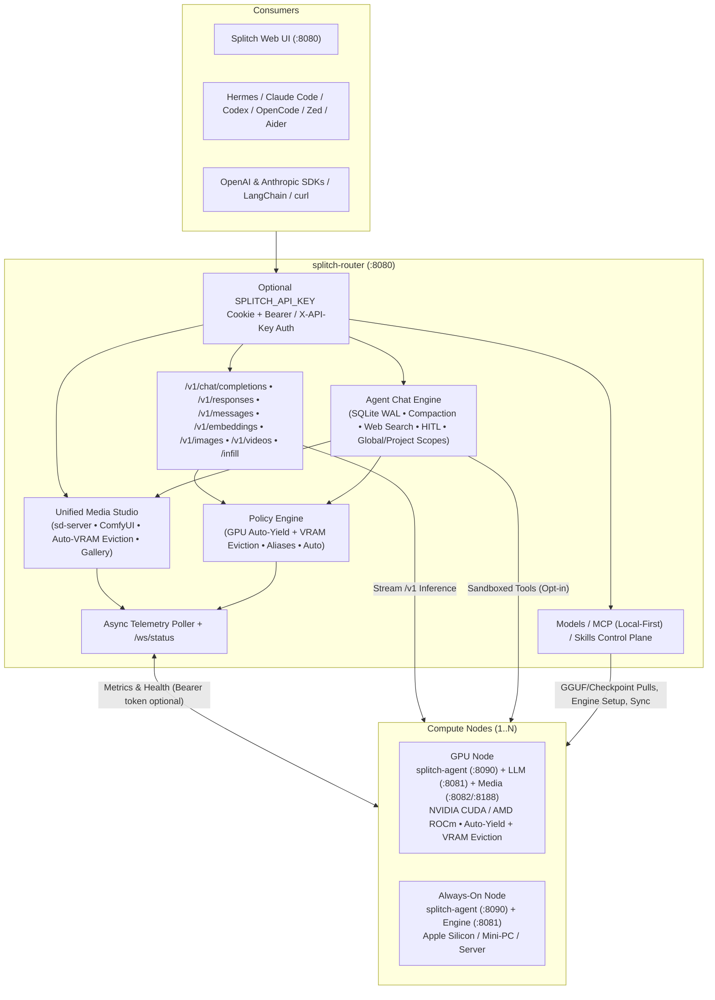

# Splitch Wiki

Welcome to the **Splitch** documentation hub. Splitch is a hardware-aware multi-node local AI router, Gaming-Mode GPU yielder, and unified Model / MCP / Skills / Agent Chat control plane.

> **GitHub Wiki Tip:** Every page in `docs/wiki/` (including `_Sidebar.md`) follows standard GitHub Wiki naming so this folder can be browsed directly in the repository **or** pushed straight to a GitHub Wiki repository.

---

## Documentation Map

1. **[Installation & Deployment](Installation-and-Deployment.md)** — 1-command installer (`install.sh` / `install.ps1`), self-updater, multi-node LAN & Tailscale clusters, inference engines (`llama-server`, Ollama, LM Studio, vLLM), Docker Compose, `systemd`, and macOS `launchd`.
2. **[CLI, Installer & Updater](CLI-and-Updater-Reference.md)** — Complete flag-by-flag reference for `splitch up|router|agent|init|doctor|update|version`, `install.sh`, and `install.ps1`.
3. **[Configuration & Routing](Configuration-and-Routing.md)** — Complete `splitch.toml` specification, environment variables, routing policy decision tree, Gaming-Mode automatic VRAM preemption, and manual overrides.
4. **[Agent Chat Guide](Agent-Chat-Guide.md)** — Full walkthrough of Agent Chat: pre-prompt settings, Workspace Folder Browser, HITL tool approvals, Web Search toggle, Context Progress Ring, Non-Destructive Auto-Compact & Manual Compact, Inline Sandboxed HTML/JS/SVG Previews, Pinned Chats, Multi-Select Bulk Delete, Trash Bin recovery, and Themes.
5. **[Models, MCP & Skills](Models-MCP-and-Skills.md)** — Hugging Face GGUF search with per-node VRAM/RAM fit badges, direct streaming pulls, hot-reloadable aliases, Official MCP Registry & npm search, Paste JSON import, Guided Python MCP Builder, OpenCode/Zed client sync, and `SKILL.md` management.
6. **[Clients & Integrations](Clients-and-Integrations.md)** — Ready-to-use configs and compatibility matrix for Hermes Agent, Claude Code (`/v1/messages`), Codex CLI (`/v1/responses`), OpenCode, Aider, Goose, OpenHands, Zed, Cline, Roo Code, Continue, Cursor, Open WebUI, LiteLLM, Python/Node/Anthropic SDKs, LangChain, and `curl`.
7. **[HTTPS & Reverse Proxies](HTTPS-and-Reverse-Proxies.md)** — Native HTTPS with and without Let's Encrypt (`splitch tls init`, `splitch tls letsencrypt`, custom CA/`mkcert`) plus production configs for Nginx, Nginx Proxy Manager, Caddy, Apache, HAProxy, Traefik, and Tailscale Serve.
8. **[API Reference](API-Reference.md)** — Complete OpenAI `/v1`, Responses `/v1/responses`, Anthropic `/v1/messages`, FIM `/infill`, Media `/v1/images` & `/v1/videos`, Control Plane, System Doctor/Update, Chat/SSE, Models, MCP, Skills, WebSocket, and Node Agent REST reference.
9. **[Security & Troubleshooting](Security-and-Troubleshooting.md)** — Sandboxing guarantees, optional Bearer token auth, rate limiting, strict CSP/HSTS, SSRF & iframe isolation, `splitch doctor` diagnostics, and practical fixes for common setup issues.

---

## Quick CLI Cheat Sheet

| Command | What It Does |
| --- | --- |
| `splitch up` | Auto-detect local engine and start agent + router + UI on `:8080` |
| `splitch doctor --check-updates` | Audit Python, `uv`, Node.js, GPU telemetry, LLM & media engines (`--fix --with-media` auto-remediates) |
| `splitch engine install \| update` | Install or atomically update hardware-matched `llama.cpp`, `sd.cpp` (`sd-server`), or `ollama` |
| `splitch update --with-engine` | Pull latest Splitch commits, sync Python/UI deps, update managed LLM & media engines, and restart active OS services |
| `splitch update --check` | Check upstream update status without modifying files |
| `splitch init` | Generate a starter `splitch.toml` for this machine |
| `splitch router` | Run the router & dashboard server (`:8080`) |
| `splitch agent --join <url>` | Run a node agent (`:8090`) and register with an existing router |
| `splitch version` | Print installed Splitch version |

---

## System Architecture

---

## Hardware & Backend Support Matrix

| Hardware / OS | Telemetry Source | Gaming-Mode Auto-Yield | Supported Engines |
| --- | --- | --- | --- |
| **Linux + NVIDIA GPU** | `nvidia-smi` + `nvidia-smi pmon` (per-PID LLM vs non-LLM VRAM) | Automatic (`non_llm_vram_mb`) + Manual | `llama-server`, Ollama, vLLM, LM Studio, OpenAI-compatible |
| **Linux + AMD GPU** | `rocm-smi` (VRAM, GPU util, temperature) | Automatic (util/VRAM) + Manual | `llama-server`, Ollama, vLLM, OpenAI-compatible |
| **macOS Apple Silicon** | `sysctl` + `vm_stat` + unified GPU cap (`max_recommended_working_set`) | Manual (typically `yield_on_gaming = false`) | `llama-server`, Ollama, LM Studio, MLX server |
| **Windows (NVIDIA / CPU)** | `nvidia-smi` + `psutil` | Automatic (NVIDIA) + Manual | `llama-server`, Ollama, LM Studio |
| **CPU-Only / Mini-PC / VM** | `psutil` (CPU %, RAM, disk storage) | Manual (`role = "cpu"`) | `llama-server`, Ollama, any `/v1` backend |

---

## Core Design Philosophy

1. **Zero external infrastructure:** One Python process (`splitch-router`) and one tiny agent per node (`splitch-agent`). State lives in SQLite WAL and plain JSON/TOML files under `~/.local/share/splitch`.
2. **Hardware reality over static config:** Routing decisions inspect live VRAM, active non-LLM GPU processes, mounted model storage, and in-flight requests every few seconds.
3. **Non-destructive by default:** Deleting chats moves them to a recoverable Trash bin; compacting context summarizes older turns for the LLM without deleting a single message from your thread; syncing IDE configs merges into existing JSON without clobbering unrelated settings.
4. **Opt-in trust boundaries:** Workspace tools are disabled until explicitly turned on per node, mutating tools require inline approval, and HTML/JS previews run inside a strictly isolated opaque-origin sandbox.

---

## Acknowledgments & Upstream Credits

- **𝔍𝔞𝔠𝔨𝔞𝔩𝔬𝔭𝔢 𝔐𝔬𝔬𝔫 (Jackalope Moon)** — UI/UX architecture and 3-column IDE layout improvements.

Splitch also thanks the maintainers and contributors of the open-source projects it integrates with:

- **[`ggml-org/llama.cpp`](https://github.com/ggml-org/llama.cpp)** — GGUF inference engine and prebuilt binary releases.
- **[`leejet/stable-diffusion.cpp`](https://github.com/leejet/stable-diffusion.cpp)** — lightweight C/C++ GGUF/safetensors image & video diffusion engine (`sd-server`) managed by `splitch engine install sd.cpp` and Media Studio.
- **[`ComfyUI`](https://github.com/comfyanonymous/ComfyUI)** — optional node-graph local image & video backend (`:8188`) auto-detected by `splitch-agent`.
- **[`Ollama`](https://github.com/ollama/ollama)** — local LLM runtime backend.
- **[`Graphify` (`graphifyy`)](https://pypi.org/project/graphifyy/)** — local tree-sitter AST knowledge graph MCP server.
- **[`Model Context Protocol (MCP)`](https://modelcontextprotocol.io/)** & **[`Official MCP Registry`](https://registry.modelcontextprotocol.io/)** — open tool protocol and registry catalogs.
- **[`skills.sh` / `agentskills.io`](https://skills.sh/)** — open `SKILL.md` agent skills ecosystem.
- **[`Unsloth`](https://github.com/unslothai/unsloth)** & **[`Hugging Face`](https://huggingface.co/)** — GGUF quantizations, model discovery, and installer ergonomics.
- **[`Astral uv`](https://github.com/astral-sh/uv)**, **[`FastAPI`](https://fastapi.tiangolo.com/)**, **[`Pydantic`](https://docs.pydantic.dev/)**, **[`React`](https://react.dev/)**, **[`Vite`](https://vite.dev/)**, and **[`Lucide`](https://lucide.dev/)**.
