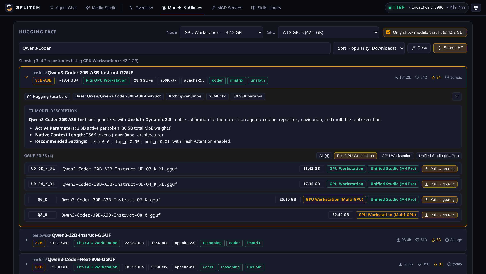
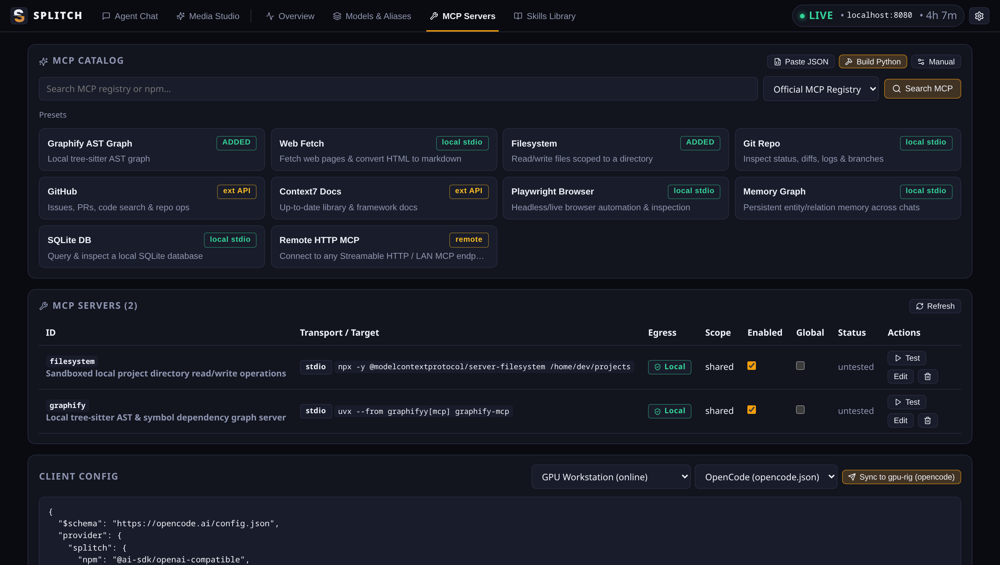
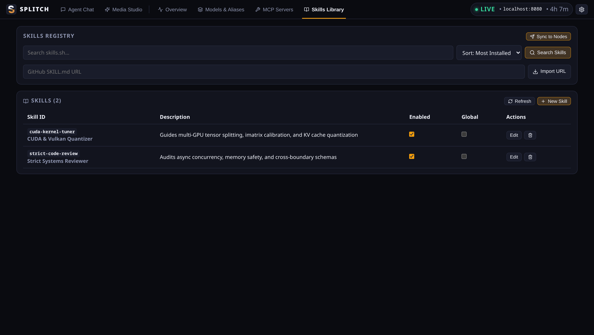

# Models, MCP & Skills Control Plane

Beyond routing and Agent Chat, Splitch provides a unified management plane across every machine in your cluster for GGUF models, routing aliases, MCP servers, and reusable `SKILL.md` agent skills.

---

## 1. Models & Logical Aliases



### Hugging Face GGUF Discovery, Fit Switch & Inline Model Cards
1. Pick a **Target Node** (and specific **GPU** on multi-GPU nodes, or `All GPUs`) in the **Models & Aliases** tab.
2. Toggle **`Only show models that fit (≤ XX.X GB)`** (`<input type="checkbox" switch>`) to filter both search result repositories and expanded GGUF files to those that fit within the selected GPU or node memory budget.
3. Search Hugging Face (e.g., `Qwen3-Coder`, `Llama-3.3`, `Gemma-3`) — results render as **full-width horizontal slices** displaying parameter count, estimated minimum GGUF size, fit badge, context length, capabilities, downloads, likes, and recency.
4. Click any repository slice to expand an inline drawer showing the cleaned **Hugging Face Model Description** (`README.md` excerpt + `Base`, `Arch`, `Context`, `Params` metadata pills) above **full-width horizontal GGUF quantization slices** with single-GPU vs `Multi-GPU` fit badges.
5. Click **Pull → `<node>`** to stream the GGUF directly into the target node's `SPLITCH_STORAGE_PATH` with real-time progress bars.

### On-Disk Inventory & Load/Unload
- View every `.gguf` stored across online nodes, check file sizes, or delete unused managed models (with confirmation dialog).
- On `llama-server` router-mode nodes, load or unload preset models on demand directly from each node card in **Overview**.

### Hot-Reloadable Aliases
Create or edit logical model aliases (`heavy`, `fast`, `fim`, `embed`, or custom names) with a `primary_node/primary_model` and optional `fallback_node/fallback_model`. Changes persist to `SPLITCH_DATA_DIR` and apply immediately to `/v1/models` and all routing decisions without restarting the router.

---

## 2. MCP Servers



Splitch acts as your single source of truth for **Model Context Protocol (MCP)** servers across both built-in Agent Chat and external IDE clients:

### 4 Ways to Add an MCP Server (Local `stdio` Prioritized Over Remote)
1. **Official MCP Registry & npm Live Search:** Search the Official MCP Registry or npm directly from the top bar — local installable `stdio` packages (`uvx` / `npx`) are automatically prioritized ahead of remote HTTP/SSE endpoints, with explicit **LOCAL STDIO**, **EXTERNAL API**, and **REMOTE MCP** privacy badges.
2. **Built-In Presets (Including Graphify AST Graph):** Instant templates starting with **Graphify AST Graph** (local tree-sitter knowledge graph via `uvx --from "graphifyy[mcp]"`, 0 cloud tokens), **Web Fetch**, **Filesystem**, **Git Repo**, **GitHub**, **Context7 Docs**, **Playwright Browser**, **Memory Graph**, **SQLite DB**, and **Remote HTTP MCP**.
3. **Paste JSON Import:** Paste standard `mcpServers` JSON snippets from Claude Desktop, Cursor, or OpenCode docs to bulk-import multiple servers at once.
4. **Guided Zero-Dependency Python MCP Builder:** Click **Build Python MCP** to generate a standalone, zero-external-dependency stdio JSON-RPC Python MCP script (stored under `SPLITCH_MCP_SCRIPTS_DIR`), sync it to nodes, and test it immediately.

### External Data Egress Advisories & HITL Protection
- Every MCP server is automatically classified as **`local`** (runs on-device or LAN), **`external_api`** (local `stdio` process configured with cloud API credentials), or **`remote_mcp`** (non-LAN HTTP/SSE endpoint).
- Whenever you configure or attach an `external_api` or `remote_mcp` server, Splitch displays an explicit **External Data Egress Advisory** warning which external domain or service receives tool arguments.
- In Agent Chat, tool calls to external/remote MCP servers automatically pause for explicit **Allow / Deny** HITL confirmation unless Auto-Approve is enabled.

### Global & Per-Project (Workspace) Scoping
- Check **Global Chat** on any row in the **MCP Servers** or **Skills Library** table to activate that MCP server or Skill globally across **every** conversation.
- Or open **Agent Chat → Context** and switch the scope target between **This Chat**, **Project (`<workspace_subpath>`)**, and **Global (All Chats)** to bind specific Skills and MCPs (such as Graphify or project-specific linters) to a specific project workspace folder.

### Live Protocol Probe (`Test`)
Click **Test** on any registered MCP server to spawn a real `initialize` + `tools/list` JSON-RPC handshake over stdio or HTTP and inspect the exact list of discovered tools and latency.

### Non-Destructive Client Config Sync (OpenCode & Zed)
Select any online node and target client (**OpenCode `opencode.json`** or **Zed `settings.json`**) to preview the generated config combining Splitch's `/v1` provider models and all enabled MCP servers, then click **Sync** to safely merge into the remote node's config file without clobbering unrelated editor settings.

---

## 3. Skills Library



Manage portable `SKILL.md` prompt instructions (YAML frontmatter + Markdown body) in one canonical directory (`SPLITCH_SKILLS_DIR`):

### Authoring & Importing Skills
- **Live `skills.sh` Search:** Search and install community skills with one click.
- **GitHub URL Import:** Paste any GitHub blob/raw URL pointing to a `SKILL.md` file.
- **Inline Editor:** Create or edit skills directly in the browser using standard frontmatter:

```markdown
---
name: Code Reviewer
description: Strict security, concurrency, and test-coverage reviewer for pull requests.
---

# Code Reviewer

1. Check for race conditions and blocking I/O on async event loops.
2. Verify input validation, auth boundaries, and path sandboxing.
3. Require focused unit tests for every behavioral change.
```

### Multi-Node Manifest Sync & Agent Chat Injection
- Click **Sync All Nodes** to push enabled skills across every online node (manifest-tracked so removed/disabled skills are cleanly pruned without touching unmanaged files).
- Inside **Agent Chat → Settings**, check any skills to inject their instructions directly into that conversation's system prompt.

---

Next: **[API Reference →](API-Reference.md)**
